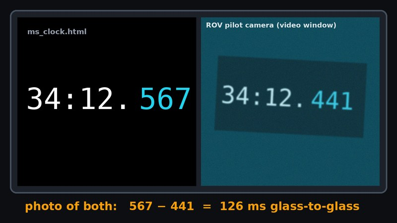
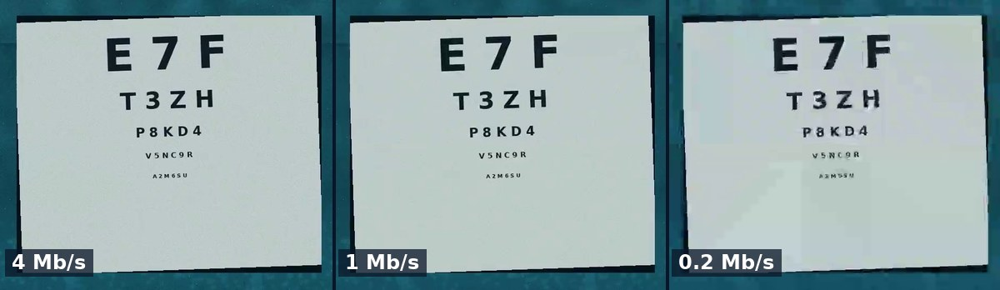

# 🧪 ROV Experiments: the homework

*M.I.A Robotics · video-streaming homework · 25 Nov 2026 · replaces the Diagnostic Checklist and the Post-Workshop Challenge*

> **Every number we argue about can be measured on our own ROV in an afternoon.** This document lists all of them as experiments: how late the pilot's picture is, how much the tether really carries, what one lost packet does, when the ROV computer gives up, how hot it gets in the hull, and whether the pilot can actually read a marking at 1 Mb/s.
>
> Do them in pairs, post every result, collect points and badges. The numbers you collect become the team's requirements, test cases and engineering documentation for MATE.

**Contents:** [How the game works](#how-the-game-works) · [Kit and setup](#kit-and-setup) · [Safety rules](#safety-rules) · [Mission map](#mission-map) · [Level 0: know your ROV](#level-0--know-your-rov) · [⏱ Latency Hunter](#-latency-hunter) · [📡 Tether Whisperer](#-tether-whisperer) · [💥 Chaos Monkey](#-chaos-monkey) · [🔥 Heat and Power](#-heat-and-power) · [🎯 Encoder Tuner](#-encoder-tuner) · [👁 Pilot's Eye](#-pilots-eye) · [👑 Boss level: the 6-week challenge](#-boss-level-the-6-week-challenge) · [Posting a result](#posting-a-result) · [Suggested schedule](#suggested-schedule)

---

## How the game works

Every experiment follows the same four steps, and **the first one is the fun one**:

| Step | What you do | Why |
|---|---|---|
| **1 · Predict** | Before touching anything, each person writes a number: "glass-to-glass will be ___ ms". | Your intuition gets calibrated. A prediction within 20 % earns a bonus. |
| **2 · Measure** | Follow the steps; repeat each measurement (10 times for latency, 3 times for most others). | One measurement is an anecdote. Report the median and the worst. |
| **3 · Explain** | One paragraph: why is the number what it is? Which stage causes it? Use the [field guide](../streaming/measure-and-diagnose.md#8-field-guide). | A number without a reason cannot be improved. |
| **4 · Post** | Open a GitHub issue with the 🧪 **Experiment result** template ([below](#posting-a-result)). | Results that are not written down are lost by next week. |

**Roles in a pair (rotate every experiment):** the *operator* runs the commands; the *recorder* writes numbers and conditions and takes photos. Bigger groups add a *skeptic*, who looks for what could make the result wrong.

### Points, ranks and badges

| Level | Points | Typical time |
|---|---|---|
| 🟢 Starter | 15 | ≤ 30 min, on the bench |
| 🟡 Core | 30 | 1 hour, sometimes in the pool |
| 🔴 Advanced | 50 | an afternoon, needs thinking and care |

| Bonus | Points | When |
|---|---|---|
| 🎯 Good prediction | +5 | your written prediction was within 20 % of the median |
| 🔁 Replicated | +10 | another pair repeated your experiment and got the same answer within 20 % (both pairs get it) |
| 🐞 Real problem found | +20 | the experiment revealed a real defect; it is now an issue with a fix plan |
| 📊 Chart of the week | +10 | the clearest chart or photo of the week, chosen at the knowledge exchange |

**Badges:** finish every experiment in a category to earn its badge: ⏱ Latency Hunter · 📡 Tether Whisperer · 💥 Chaos Monkey · 🔥 Heat and Power · 🎯 Encoder Tuner · 👁 Pilot's Eye.

**Ranks:** 🪸 Cadet (start) → 🔧 Technician (100 pts) → ⚙️ Engineer (250 pts) → 🧠 Chief Engineer (450 pts **and** 3 badges). The **👑 Boss level** is a team challenge and is scored separately.

Points are awarded by a mentor when the result issue is verified (see [Posting a result](#posting-a-result)); `python3 docs/experiments/experiment_board.py` prints the leaderboard and badges. The board is read out at the weekly knowledge exchange.

---

## Kit and setup

**Hardware:** the ROV with all cameras, the tether, the topside laptop, a second screen or a phone (for the clock), a phone camera (**slow-motion 240 fps** if it has it), a ruler or tape, a printed grey card (or plain white paper), a bucket, a pinch of milk powder (for turbidity, E22).

**Software, once:**

```bash
# ROV computer and topside (Debian / Ubuntu / Raspberry Pi OS / JetPack)
sudo apt install -y iperf3 ethtool v4l-utils ffmpeg tcpdump sysstat stress-ng htop
# topside only
sudo apt install -y wireshark            # Windows/macOS: wireshark.org installer
pip install -r encoding_lab/requirements.txt
```

**Write these once at the top of your notes, and use them in every command:**

```bash
ROV=192.168.2.2        # ROV computer IP   (ip -br addr on the ROV)
TOP=192.168.2.1        # topside laptop IP
IF=eth0                # tether interface on the ROV (ip -br link)
CAM=/dev/video0        # one camera        (v4l2-ctl --list-devices)
```

**Tools already in this repo:**

- **ms clock:** open [`docs/experiments/ms_clock.html`](ms_clock.html) in a browser and press F for full screen. It runs offline.
- **Encoding Lab:** `streamlit run encoding_lab/app.py`.
- **RTP probe:** `python3 encoding_lab/tools/rtp_probe.py --port 5600 --forward 5601` (throughput, loss and jitter per stream).

---

## Safety rules

1. **Thrusters:** run them only with the ROV in water or firmly restrained, props guarded, hands away. For bench experiments that do not need thrust, remove the props.
2. **Power and water:** never open the enclosure while powered. Dry hands, fused supply, tether strain-relieved.
3. **`tc` affects ALL traffic, including control.** Use `tc netem` and `tc tbf` (E10–E12) only on the bench with props off. Remove them afterwards and check:
   ```bash
   sudo tc qdisc del dev $IF root; tc qdisc show dev $IF    # must show only the default qdisc
   ```
4. **Heat:** in soak tests (E15), stop if the computer stays above its throttle point (Pi 5: 85 °C) for more than 5 minutes.
5. **Restore what you change.** Before touching camera settings, run `v4l2-ctl -d $CAM --list-ctrls > before.txt`; restore from it afterwards.

---

## Mission map

| # | Experiment | Badge | Level | Pts | Where |
|---|---|---|---|---|---|
| E0 | Know your ROV (inventory) | required first | 🟢 | 30 | bench |
| E1 | How late is the pilot? (glass-to-glass) | ⏱ | 🟢 | 15 | bench |
| E2 | Where do the milliseconds go? | ⏱ | 🟡 | 30 | bench |
| E3 | Hunt the frames the encoder hides | ⏱ | 🟡 | 30 | bench |
| E4 | Camera switch stopwatch | ⏱ | 🟢 | 15 | bench |
| E5 | The long dive (latency drift) | ⏱ | 🟡 | 30 | bench / pool |
| E6 | Tether truth | 📡 | 🟢 | 15 | bench + pool |
| E7 | Bandwidth census | 📡 | 🟢 | 15 | bench |
| E8 | Keyframe pile-up | 📡 | 🔴 | 50 | bench |
| E9 | The MTU detective | 📡 | 🟡 | 30 | bench |
| E10 | Packet-loss torture | 💥 | 🟡 | 30 | bench |
| E11 | Jitter vs the buffer | 💥 | 🟡 | 30 | bench |
| E12 | The squeeze | 💥 | 🔴 | 50 | bench |
| E13 | Pull the plug | 💥 | 🟡 | 30 | bench |
| E14 | Does the UI tell the truth? | 💥 | 🟢 | 15 | bench |
| E15 | Recording vs power cut | 💥 | 🟢 | 15 | bench |
| E16 | The 30-minute soak | 🔥 | 🟡 | 30 | pool or water tank |
| E17 | Power under thruster load | 🔥 | 🟡 | 30 | pool |
| E18 | Your footage's bits-per-pixel | 🎯 | 🟢 | 15 | pool + Lab |
| E19 | How many cameras can the ROV computer encode? | 🎯 | 🔴 | 50 | bench |
| E20 | The resolution trap | 🎯 | 🟢 | 15 | bench |
| E21 | USB bus limit | 🎯 | 🟡 | 30 | bench |
| E22 | Lights vs backscatter (bucket of milk) | 👁 | 🟢 | 15 | bucket |
| E23 | Camera settings under water | 👁 | 🟡 | 30 | pool |
| E24 | Eye test for the ROV | 👁 | 🟡 | 30 | pool / tank |
| E25 | Pilot blind test | 👁 | 🔴 | 50 | pool |
| E26 | The LED race (telemetry vs video) | 👁 | 🔴 | 50 | bench |

---

## Level 0 · Know your ROV

### E0 · Know your ROV (inventory) 🟢 30 pts · required before everything else

**Question.** What does our video system *actually* consist of, today? Fill this in before changing anything. "Unknown" is an acceptable answer: it becomes a task.

**Predict.** Before measuring, each person writes down how many cameras use MJPEG and the total Mb/s of video on the tether.

Record the date, the software version and the conditions: ☐ bench ☐ pool ☐ enclosure closed ☐ thrusters running.

**Onboard computer**

| # | Check | How | Result |
|---|---|---|---|
| 0.1 | Exact board | `cat /proc/device-tree/model` | |
| 0.2 | Jetson: L4T / JetPack version (R32 = Nano; R35/R36 = Orin) | `cat /etc/nv_tegra_release` | |
| 0.3 | Pi: OS release | `cat /etc/os-release` | |
| 0.4 | Hardware encoder actually usable? | Jetson: `gst-inspect-1.0 nvv4l2h264enc` · any: a 1-second test encode | ☐ yes ☐ no |
| 0.5 | Which processes handle video? | `ps aux \| grep -Ei "ffmpeg\|gst\|mjpg\|ustreamer\|mediamtx\|python"` | |
| 0.6 | Memory with all cameras streaming | `free -m` | |

**Cameras: one row per camera**

| # | Position / role | Model | USB or IP | Formats supported | Format in use | Resolution | FPS | Who encodes (camera / ROV / nobody) |
|---|---|---|---|---|---|---|---|---|
| C1 | | | | | | | | |
| C2 | | | | | | | | |
| C3 | | | | | | | | |
| C4 | | | | | | | | |
| C5–C8 | | | | | | | | |

How: `v4l2-ctl --list-devices`, `v4l2-ctl -d /dev/videoN --list-formats-ext`, `v4l2-ctl -d /dev/videoN --get-fmt-video`. IP cameras: the camera's web page and `ffprobe -hide_banner rtsp://<ip>/<path>`.

**Streams: one row per stream on the tether**

| # | Stream | Protocol (RTP / RTSP / WebRTC / HTTP-MJPEG) | UDP or TCP | Codec | Resolution | FPS | GOP | B-frames? |
|---|---|---|---|---|---|---|---|---|
| S1 | | | | | | | | |
| S2 | | | | | | | | |

How: `ffprobe -v error -show_streams -of json <url>`; GOP and B-frames: `ffprobe -v error -show_entries frame=pict_type -of csv=p=0 <recording> | head -100`.

**Topside**

| # | Check | How | Result |
|---|---|---|---|
| 0.7 | Laptop, CPU, GPU, OS, browser version | | |
| 0.8 | What decodes the video (browser `<video>`, WebRTC, `` MJPEG, native player)? | code / DevTools | |
| 0.9 | Hardware decoding used? | `chrome://gpu` (Video Acceleration), `chrome://media-internals` | |
| 0.10 | Do control and telemetry share the tether with video? Any priority? | design / code | |

**Draw it:** cameras → USB hubs / switch → ROV computer → tether → topside, with IP addresses. Attach a photo of the drawing.

**Done when:** every row is filled or marked "unknown → issue #__". Post the tables as one issue; they are the baseline for everything below.

---

## ⏱ Latency Hunter

### E1 · How late is the pilot? (glass-to-glass) 🟢 15 pts

**Question.** How many milliseconds pass between something happening in front of the pilot camera and the pilot seeing it?

**Predict.** ___ ms (median) and ___ ms (worst).

**Why it matters.** Above ≈ 150 ms pilots start to over-correct; a manipulator grab becomes trial and error. This is the number the pilot feels.

**You need:** [ms_clock.html](ms_clock.html) on the topside screen, the pilot camera pointed at that screen, and a phone.

1. Open `ms_clock.html` full screen on the topside laptop (or on a second screen next to it).
2. Point the pilot camera at the clock. Put the video window on the **same** screen, next to the clock.
3. Photograph both with the phone. **Latency = clock − clock-in-the-video.**

   

4. Repeat 10 times, a few seconds apart. Faster: film 10 s in slow motion and read 10 frames.
5. Repeat with **all** cameras streaming, then with the thrusters running.

**Record**

| Condition | Median (ms) | Worst (ms) | Notes |
|---|---|---|---|
| Pilot camera alone | | | |
| All cameras streaming | | | |
| All cameras + thrusters | | | |

**Good looks like:** median ≤ 150 ms, worst ≤ 250 ms. MJPEG passthrough on a clean link: about 60–120 ms.

**Go further:** the screen refresh adds up to 1 frame (16.7 ms at 60 Hz). The clock page shows the screen's Hz; a 144 Hz laptop screen shrinks the error.

### E2 · Where do the milliseconds go? 🟡 30 pts

**Question.** Of the total latency from E1, how much does each stage add?

**Predict.** Draw a bar: capture ___ · encode ___ · network ___ · buffer ___ · decode ___ · display ___ ms.

**Method:** measure glass-to-glass (E1 method, 10 repeats each) while changing **one** stage at a time:

| Change | Command / setting | Median (ms) | Δ vs baseline |
|---|---|---|---|
| Baseline (today's setup) | | | 0 |
| Player without buffering | `ffplay -fflags nobuffer -flags low_delay -framedrop <url>` | | |
| GStreamer jitter buffer 200 → 50 → 0 ms | `rtpjitterbuffer latency=50` | | |
| Encoder low-latency | x264 `-tune zerolatency -bf 0`; NVENC `-tune ull -delay 0` | | |
| Camera fps 15 → 30 → 60 | `v4l2-ctl -d $CAM --set-parm=60` | | |
| Display: TV game mode on / laptop screen | | | |
| Ping round-trip / 2 (network share) | `ping -c 50 $ROV` | | |

**Explain:** which change saved the most? Compare with the latency chart in the [measure-and-diagnose doc](../streaming/measure-and-diagnose.md#4-measuring-latency-properly).

**Good looks like:** you can name the two biggest stages and you have removed at least one of them.

### E3 · Hunt the frames the encoder hides 🟡 30 pts

**Question.** How many frames does our encoder hold before it outputs anything?

**Predict.** ___ frames held with today's settings.

1. **On a laptop:** Encoding Lab → **Live camera** → encoder x264 → *Low latency* off, then on. Read the **held** number and the encoder ms.
2. **On the ROV:** run the real pipeline twice, with default and with low-latency settings (x264 `-tune zerolatency`; on a Jetson `nvv4l2h264enc` with `maxperf-enable=1` and no B-frames). Measure glass-to-glass (E1) for each.
3. Held frames ≈ (latency difference) ÷ frame time.

| Encoder settings | Held frames (Lab) | Glass-to-glass median (ROV) |
|---|---|---|
| defaults | | |
| low latency | | |

**Good looks like:** 0 held frames on every live stream. (Measured in the Lab: x264 defaults held 31 frames, ≈ 1 s, at 720p30.)

### E4 · Camera switch stopwatch 🟢 15 pts

**Question.** When the pilot switches camera, how long until the new picture is live?

**Predict.** ___ ms.

1. Film the keyboard and the screen together in slow motion.
2. Count the frames from the key press to the first sharp, moving picture of the new camera (240 fps: 1 frame = 4.2 ms).
3. Repeat 5 times for 3 different cameras.

| Camera | Switch time, median (ms) | Worst (ms) | GOP of that stream |
|---|---|---|---|
| | | | |

**Explain:** compare the switch time with the GOP length. A decoder cannot show a picture before the next keyframe.

**Good looks like:** ≤ 1 s. **Go further:** request a keyframe on switch, or keep a low-rate stream of every camera running.

### E5 · The long dive (latency drift) 🟡 30 pts

**Question.** Is latency the same after 30 minutes as after 1 minute?

**Predict.** After 30 min: ___ ms.

1. Start all streams. Measure glass-to-glass (5 photos) at t = 1, 10, 20 and 30 min.
2. Keep the GUI open the whole time; do not restart anything.

| t (min) | 1 | 10 | 20 | 30 |
|---|---|---|---|---|
| Median (ms) | | | | |

**Explain:** a straight rising line means a queue that only grows. Find it ([field guide: latency drift](../streaming/measure-and-diagnose.md#latency-drift)).

**Good looks like:** flat within ± 20 ms.

---

## 📡 Tether Whisperer

### E6 · Tether truth 🟢 15 pts

**Question.** What does the tether really carry, in the direction the video goes (ROV → topside), with and without thrusters?

**Predict.** ___ Mb/s TCP.

```bash
# topside
iperf3 -s
# ROV: TCP for 30 s, then UDP at increasing rates until loss appears
ethtool $IF | grep -E "Speed|Duplex"
iperf3 -c $TOP -t 30
iperf3 -c $TOP -u -b 50M -t 30          # then 70M, 90M …: note where loss starts
ethtool -S $IF | grep -Ei "err|drop|crc"   # before and after
```

| Test | Thrusters off | Thrusters on (pool) |
|---|---|---|
| Link speed / duplex (both ends) | | |
| TCP Mb/s | | |
| UDP Mb/s at < 0.1 % loss | | |
| UDP jitter (ms) | | |
| Interface errors after the test | | |
| `ping -c 50 $TOP` idle / during video (ms) | | |

**Good looks like:** speed and duplex as expected on **both** ends; thrusters change nothing. If thrusters add loss or errors, you found electrical noise: 🐞 bonus.

### E7 · Bandwidth census 🟢 15 pts

**Question.** How many Mb/s does each stream use, on average and at its peak, and what is the total against the tether?

**Predict.** Total ___ Mb/s.

```bash
# topside, one probe per stream port (forward to where the player listens)
python3 encoding_lab/tools/rtp_probe.py --port 5600 --forward 5601 --seconds 60 --json > cam1.json
# all traffic on the ROV interface, 1-second samples
sar -n DEV 1 60 | grep $IF
```

| Stream | Avg Mb/s | Peak 1 s Mb/s | Loss % | Jitter ms |
|---|---|---|---|---|
| | | | | |
| **Total** | | | | |

**Total ÷ TCP throughput from E6 = ___ %.** **Good looks like:** ≤ 70 %. Put the numbers into Encoding Lab → **Bandwidth budget** and compare with its estimate.

### E8 · Keyframe pile-up 🔴 50 pts

**Question.** Do the cameras' keyframes arrive together, and what does that do to the tether every second?

**Predict.** Peak over 10 ms windows: ___ Mb/s.

1. Capture 30 s of video traffic on the topside: `sudo tcpdump -i <topside-iface> -w burst.pcap udp`.
2. Wireshark → Statistics → **I/O Graphs** → interval **10 ms**, Y axis bits per interval. Screenshot it.
3. Restart all streams **at the same moment** (one `systemctl restart`), capture again. Then start them **2 s apart**, capture again.

| Start | Peak per 10 ms (Mb/s equivalent) | Spikes per second | Glass-to-glass worst (ms) |
|---|---|---|---|
| Together | | | |
| Staggered | | | |

**Explain:** a keyframe is ≈ 4–5× a normal frame (measured in the Lab). Why do synchronised starts make it worse?

**Go further:** try intra refresh (x264 `-intra-refresh 1`) and compare the graph.

### E9 · The MTU detective 🟡 30 pts

**Question.** Does any video packet get fragmented on the way to the topside?

**Predict.** ☐ yes ☐ no.

```bash
ip link show $IF | grep -o "mtu [0-9]*"
ping -M do -s 1472 -c 3 $TOP        # 1472 + 28 = 1500 bytes; lower -s until it works
sudo tcpdump -ni <topside-iface> 'ip[6:2] & 0x3fff != 0' -c 20     # prints only fragments
```

| Real path MTU | Largest video datagram seen | Fragments seen? |
|---|---|---|
| | | |

**Good looks like:** no fragments. If you see some, keep RTP payloads at 1200–1400 bytes (`pkt_size=1316` in FFmpeg URLs; `mtu=1400` on GStreamer payloaders).

---

## 💥 Chaos Monkey

*Bench only, props off, `tc` removed afterwards (see the [safety rules](#safety-rules)).*

### E10 · Packet-loss torture 🟡 30 pts

**Question.** What does 0.1 %, 1 % and 5 % packet loss do to the picture, and how long does it stay broken?

**Predict.** At 1 % loss the picture is broken ___ % of the time.

```bash
sudo tc qdisc add dev $IF root netem loss 1%      # on the ROV: affects everything it sends
sudo tc qdisc change dev $IF root netem loss 5%
sudo tc qdisc del dev $IF root
```

For each loss rate, film the screen for 60 s and count the seconds with a broken picture. Run each loss rate with GOP 1 s, GOP 5 s, and intra refresh.

| Loss | GOP 1 s: broken s/min | GOP 5 s: broken s/min | Intra refresh: broken s/min | rtp_probe loss % |
|---|---|---|---|---|
| 0.1 % | | | | |
| 1 % | | | | |
| 5 % | | | | |

**Explain:** compare with the planner (Encoding Lab → Bandwidth budget → *Broken picture* card) and the Lab's Packet-loss lab. MJPEG for comparison: what happens?

### E11 · Jitter vs the buffer 🟡 30 pts

**Question.** How big must the receiver's buffer be for a smooth picture on a jittery link, and what does that cost in latency?

**Predict.** Buffer needed: ___ ms.

```bash
sudo tc qdisc add dev $IF root netem delay 20ms 10ms distribution normal
```

Set the receiver buffer to 0, 50, 100 and 200 ms (GStreamer `rtpjitterbuffer latency=`, or the player's setting). Count stutters per minute and measure glass-to-glass.

| Buffer (ms) | Stutters / min | Glass-to-glass median (ms) |
|---|---|---|
| 0 | | |
| 50 | | |
| 100 | | |
| 200 | | |

**Good looks like:** you can draw the trade-off curve and pick the smallest buffer that is smooth enough for the pilot.

### E12 · The squeeze 🔴 50 pts

**Question.** When the tether suddenly carries less, what breaks first, and does control keep working?

**Predict.** The first camera to fail will be ___.

```bash
sudo tc qdisc add dev $IF root tbf rate 20mbit burst 32kbit latency 50ms
sudo tc qdisc change dev $IF root tbf rate 10mbit burst 32kbit latency 50ms   # then 5mbit, 2mbit
```

| Rate | What the pilot sees per camera | Control / telemetry still responsive? | `ping` RTT (ms) |
|---|---|---|---|
| 20 Mb/s | | | |
| 10 Mb/s | | | |
| 5 Mb/s | | | |
| 2 Mb/s | | | |

**Good looks like:** cameras degrade in priority order (aux first, pilot last), the UI says so, and control never stops. If control stops, you found the most important bug of the season: 🐞 bonus.

### E13 · Pull the plug 🟡 30 pts

**Question.** Does the system recover by itself from the failures that happen at competition?

**Predict.** How many of the six drills recover without touching anything? ___

| # | Drill | What happened? | Recovered by itself? Time (s) |
|---|---|---|---|
| 13.1 | Unplug one camera while streaming, plug it back | | |
| 13.2 | Unplug the tether for 1 s | | |
| 13.3 | Unplug the tether for 10 s | | |
| 13.4 | Switch cameras rapidly for 10 s | | |
| 13.5 | Load the ROV CPU: `stress-ng --cpu 4 -t 60` | | |
| 13.6 | Restart the streaming service while the GUI is open | | |

**Good looks like:** all six recover with no restart, and the GUI shows the right state the whole time.

### E14 · Does the UI tell the truth? 🟢 15 pts

**Question.** If a stream silently stops, does the GUI notice, or does it keep showing a frozen picture as if it were live?

**Predict.** ___ ms until the GUI shows something is wrong.

```bash
# on the ROV: freeze one camera's encoder without closing anything
kill -STOP <pid>     # find the pid with: ps aux | grep -Ei "ffmpeg|gst"
# … film the GUI for 10 s …
kill -CONT <pid>
```

| GUI shows STALE / LOST after (ms) | Frozen frame shown as live? | Recovers after CONT? |
|---|---|---|
| | ☐ yes ☐ no | |

**Good looks like:** a STALE badge within 500 ms, LOST after a few seconds, and recovery by itself. If the frozen frame looks live, open a 🐞 issue: it is the most dangerous video bug for a pilot.

### E15 · Recording vs power cut 🟢 15 pts

**Question.** If the ROV loses power mid-recording, is the recording still playable?

**Predict.** ☐ MP4 survives ☐ MKV survives.

```bash
ffmpeg -i <stream-url> -c copy rec.mp4 &  P1=$!
ffmpeg -i <stream-url> -c copy rec.mkv &  P2=$!
ffmpeg -i <stream-url> -c copy -movflags +frag_keyframe+empty_moov rec_frag.mp4 &  P3=$!
sleep 20; kill -9 $P1 $P2 $P3        # simulates a power cut: no clean shutdown
ffprobe rec.mp4; ffprobe rec.mkv; ffprobe rec_frag.mp4
```

| File | Plays? | Seconds recovered |
|---|---|---|
| `rec.mp4` | | |
| `rec.mkv` | | |
| `rec_frag.mp4` | | |

**Explain:** where does a plain MP4 store its index? Change the team's recorder if needed.

---

## 🔥 Heat and Power

### E16 · The 30-minute soak 🟡 30 pts

**Question.** Does the video system still work after 30 minutes in the sealed hull, in water, with everything running?

**Predict.** Temperature after 30 min: ___ °C. Throttling: ☐ yes ☐ no.

```bash
# Raspberry Pi
while true; do echo "$(date +%T) $(vcgencmd measure_temp) $(vcgencmd get_throttled)"; sleep 5; done | tee soak.log
# Jetson
sudo tegrastats --interval 5000 --logfile soak.log
```

Enclosure closed, all cameras streaming, GUI running, thrusters at a typical duty. Measure glass-to-glass and fps at t = 1 min and t = 30 min.

| | t = 1 min | t = 30 min |
|---|---|---|
| Temperature (°C) | | |
| Throttled? (`0x0` = never) | | |
| Glass-to-glass median (ms) | | |
| Stream fps (rtp_probe / GUI) | | |

**Good looks like:** no throttling, latency and fps unchanged. Plot temperature over time from `soak.log` for 📊 bonus points. Read [the 2023 heat failure](../streaming/hardware-and-encoders.md#4-reliability-the-2023-heat-failure-and-how-to-prevent-it) first.

### E17 · Power under thruster load 🟡 30 pts

**Question.** Does running the thrusters brown out the computer or reset the cameras?

**Predict.** ☐ USB resets ☐ under-voltage ☐ nothing.

```bash
dmesg -w | grep -Ei "voltage|usb .*(reset|disconnect)|uvcvideo"     # leave running
vcgencmd get_throttled       # Pi: bit 0 = under-voltage now, bit 16 = has happened
```

1. Ramp all thrusters to full, then reverse quickly, 5 times.
2. Power-cycle the ROV 10 times; count how often every camera starts.

| Test | Result |
|---|---|
| dmesg events during thrust reversals | |
| Under-voltage flag | |
| Cameras starting correctly | __ / 10 |

**Good looks like:** no events, 10 / 10. Anything else is a 🐞: separate camera power from thruster power, check the supply.

---

## 🎯 Encoder Tuner

### E18 · Your footage's bits-per-pixel 🟢 15 pts

**Question.** How many bits per pixel does **our** underwater footage need for good quality? Every bandwidth estimate depends on this number.

**Predict.** H.264 at SSIM 0.98 needs ___ bits per pixel.

1. In the pool, record 60 s from each important camera without re-encoding:
   ```bash
   ffmpeg -f v4l2 -input_format mjpeg -video_size 1280x720 -framerate 30 -i $CAM -c copy -t 60 pilot.mkv
   ```
2. Encoding Lab → sidebar → **Upload your own video**. Encode tab: find the bitrate where SSIM ≥ 0.98 (or use the Sweep tab).
3. bits per pixel = bitrate ÷ (width × height × fps). Put it into **Bandwidth budget → Bits per pixel**, or press *Use my last encode*.

| Camera | Scene | Bitrate at SSIM 0.98 | Bits per pixel | Lab default |
|---|---|---|---|---|
| | | | | 0.045 (H.264) |

**Explain:** is our footage harder or easier than the Lab's synthetic clip? Why (particles, light, motion)?

### E19 · How many cameras can the ROV computer encode? 🔴 50 pts

**Question.** How many real-time streams can our ROV computer encode before it falls behind?

**Predict.** ___ × 720p30 H.264.

**Raspberry Pi 5 / any Linux with FFmpeg:** start N encoders at once from a test pattern and read their speed. Every speed ≥ 1.0x means real time:

```bash
N=4
for i in $(seq 1 $N); do
  ffmpeg -hide_banner -f lavfi -i testsrc2=size=1280x720:rate=30 -t 20 \
         -c:v libx264 -preset ultrafast -tune zerolatency -f null - 2>&1 | grep -o "speed=[ 0-9.]*x" | tail -1 &
done; wait
```

**Jetson (hardware encoder, GStreamer):** time 600 frames per stream; under 20 s means faster than 30 fps:

```bash
time gst-launch-1.0 -q videotestsrc num-buffers=600 ! video/x-raw,width=1280,height=720,framerate=30/1 ! \
  nvvidconv ! 'video/x-raw(memory:NVMM),format=NV12' ! nvv4l2h264enc maxperf-enable=1 ! fakesink sync=false
```

Run it with N copies in parallel (`&` and `wait`) and raise N until it slows down. The test pattern itself costs CPU, so the real limit is a little higher. Note it.

| N streams | 720p30: slowest speed (×) | CPU % (htop) | Temperature |
|---|---|---|---|
| 1 | | | |
| 2 | | | |
| 4 | | | |
| 8 | | | |

**Good looks like:** you know N at ≤ 70 % CPU. Compare with [Jetson Nano vs Pi 5](../streaming/hardware-and-encoders.md#2-jetson-nano-2gb-vs-raspberry-pi-5-for-our-cameras). If the Encoding Lab runs on the board (Pi 5), also run **Bandwidth budget → Measure this computer** and plan with *This computer (benchmarked)*.

### E20 · The resolution trap 🟢 15 pts

**Question.** Is lowering an MJPEG camera's resolution free, or does it cost CPU?

**Predict.** Software resize costs ___ % CPU.

```bash
# A: ask the camera for the small mode (no decoding)
ffmpeg -f v4l2 -input_format mjpeg -video_size 640x360 -framerate 30 -i $CAM -c copy -f null - &
pidstat -u 1 10 -p $!
# B: capture big, shrink in software (decode → scale → encode)
ffmpeg -f v4l2 -input_format mjpeg -video_size 1920x1080 -framerate 30 -i $CAM -vf scale=640:360 -c:v mjpeg -q:v 5 -f null - &
pidstat -u 1 10 -p $!
```

| Method | CPU % | Output Mb/s |
|---|---|---|
| A · camera mode | | |
| B · software resize | | |

**Explain:** which one does our current setup do? Check with [the resolution trap](../streaming/codecs-and-ffmpeg.md#the-resolution-trap).

### E21 · USB bus limit 🟡 30 pts

**Question.** How many cameras can one USB bus feed, in MJPEG and in raw (YUYV) mode?

**Predict.** ___ cameras on one bus.

```bash
lsusb -t                                     # which cameras share a bus, at 480M or 5000M
v4l2-ctl -d /dev/videoN --list-formats-ext   # MJPG and YUYV modes
```

Start the cameras one by one in YUYV 640×480@30, then in MJPEG 1280×720@30, until one fails ("No space left on device") or drops frames.

| Mode | Cameras working on one bus | Error seen |
|---|---|---|
| YUYV 640×480@30 | | |
| MJPEG 1280×720@30 | | |

**Good looks like:** every camera has room, with cameras spread over separate controllers if needed.

---

## 👁 Pilot's Eye

### E22 · Lights vs backscatter (bucket of milk) 🟢 15 pts

**Question.** Where should the lights go so particles do not fill the picture?

**Predict.** The best light position is ___.

1. Fill a bucket or tank with water and stir in a **pinch** of milk powder: just enough to look like murky water.
2. Put an object 30 cm from the camera. Try the light next to the lens, 20 cm to the side, and 20 cm to the side and slightly behind the lens, angled outward.
3. Photograph each. Record the still-scene bitrate for each (Lab upload, or E7 on a live stream).

| Light position | Specks visible (few / many) | Object contrast (1–5) | Still-scene Mb/s |
|---|---|---|---|
| Next to the lens | | | |
| 20 cm to the side | | | |
| To the side and behind the lens | | | |

**Explain:** why do particles cost bits? ([field guide: backscatter](../streaming/measure-and-diagnose.md#backscatter))

### E23 · Camera settings under water 🟡 30 pts

**Question.** Do manual exposure, white balance and focus give a better picture, and fewer bits, than auto?

**Predict.** Manual settings save ___ % bitrate on a still scene.

```bash
v4l2-ctl -d $CAM --list-ctrls > before.txt          # names differ between cameras: read this list first
v4l2-ctl -d $CAM -c auto_exposure=1 -c exposure_time_absolute=150     # older kernels: exposure_auto / exposure_absolute
v4l2-ctl -d $CAM -c white_balance_automatic=0 -c white_balance_temperature=5000
v4l2-ctl -d $CAM -c focus_automatic_continuous=0 -c focus_absolute=0
```

At working depth, hold a grey card in front of the camera, then record 10 s of a still scene with auto settings and 10 s with manual settings.

| Setting | Auto | Manual (values) |
|---|---|---|
| Exposure / gain | | |
| White balance | | |
| Focus | | |
| Still-scene Mb/s at the same CRF (Lab) | | |
| Pilot's rating 1–5 | | |

**Explain:** noise is detail the encoder must send. The Lab measured 3.6× more bitrate for a noisy clip at the same quality.

### E24 · Eye test for the ROV 🟡 30 pts

**Question.** What is the lowest bitrate at which the pilot can still read the smallest marking the mission needs?

**Predict.** Minimum readable bitrate: ___ Mb/s.

1. Print an "eye chart": rows of letters and digits 40, 20, 10 and 5 mm high (plus the smallest marking from the MATE mission props), and laminate it.
2. Put it 1 m in front of the pilot camera, under water.
3. Set the pilot stream to 8, 4, 2, 1 and 0.5 Mb/s. At each, the pilot reads the smallest row they can; the recorder checks the answers.

| Bitrate (Mb/s) | 8 | 4 | 2 | 1 | 0.5 |
|---|---|---|---|---|---|
| Smallest row read correctly (mm) | | | | | |
| Pilot comment | | | | | |



*A real x264 encode (veryfast, zerolatency) of a drifting, slightly noisy underwater view of the chart. At 1 Mb/s every row still reads; at 0.2 Mb/s the smallest row is gone and the row above it breaks up. Your threshold will differ: that is why you measure it.*

**Good looks like:** you know the bitrate below which the mission becomes impossible. That number goes into requirement N2 of the [boss level](#-boss-level-the-6-week-challenge).

### E25 · Pilot blind test 🔴 50 pts

**Question.** Which of two settings makes the pilot faster and more accurate when the pilot does not know which one is on?

**Predict.** Setting ___ wins by ___ s.

1. Choose two settings to compare, for example *720p30 at 2 Mb/s* vs *1080p15 at 4 Mb/s*, or *low latency* vs *defaults*.
2. Choose a task: pick up an object and drop it in a bin, or touch 3 targets in order.
3. Run 6 attempts: 3 per setting, in an order chosen by a coin flip and hidden from the pilot.
4. Time each attempt, count errors, and ask the pilot to rate each 1–5.

| Attempt | Setting (hidden) | Time (s) | Errors | Rating |
|---|---|---|---|---|
| 1–6 | | | | |

**Explain:** did the pilot's ratings agree with the times? Did the faster picture or the sharper picture win?

### E26 · The LED race (telemetry vs video) 🔴 50 pts

**Question.** How much older is the video than the telemetry the pilot sees next to it?

**Predict.** The video is ___ ms behind the telemetry.

1. Wire an LED to a GPIO pin of the ROV computer, in view of a camera.
2. A small script toggles the LED every 2 s **and** sends "LED ON / OFF" in the telemetry the GUI already shows.
3. Film the GUI in slow motion: count the frames between the telemetry indicator changing and the LED changing in the video.

| Repeats | Median lag video − telemetry (ms) | Worst (ms) |
|---|---|---|
| 10 | | |

**Explain:** is the HUD showing where the ROV *is* while the video shows where it *was*? Should the overlay be delayed to match? ([field guide: desync](../streaming/measure-and-diagnose.md#telemetryvideo-and-audio-desync))

---

## 👑 Boss level: the 6-week challenge

> **Mission:** *Optimize the ROV video system to give the pilot the best possible experience under limited bandwidth and processing.*

A team challenge for the software and electronics members who own video, plus at least one pilot. It turns the experiments above into a better system. **The baseline is your experiment results**; every later decision must refer back to them.

**Deliverables:** a 10-minute demonstration, and a short engineering report (≤ 6 pages) to reuse in the MATE technical documentation.

### Requirements

Replace the ⟨…⟩ targets with numbers agreed with the pilots **after** the experiments. Keep the IDs: tests trace to them.

| ID | Functional requirement |
|---|---|
| F1 | The pilot can select the primary camera with one key or button, from any screen. |
| F2 | Every camera shows an explicit state: LIVE, DEGRADED, PAUSED, LOST, CONNECTING. A frozen frame is never shown as live (E14). |
| F3 | The primary camera can be recorded at full quality without affecting the live view, and the recording survives a power cut (E15). |
| F4 | A camera that disconnects reconnects automatically, without restarting the application (E13). |
| F5 | When link capacity drops, cameras degrade in priority order; the pilot and manipulator cameras are protected (E12). |
| F6 | The control and telemetry channel keeps working when video saturates the link (E12). |

| ID | Non-functional requirement | Example target | Measured by |
|---|---|---|---|
| N1 | Pilot-camera glass-to-glass latency, all cameras streaming | median ≤ ⟨150⟩ ms, worst ≤ ⟨250⟩ ms | E1, E5 |
| N2 | Pilot-camera quality | the pilot reads ⟨the smallest mission marking⟩ at ⟨1 m⟩ | E24 |
| N3 | Bandwidth | total video ≤ 70 % of measured tether throughput | E6, E7 |
| N4 | Onboard load and heat | ≥ 1 CPU core free; no throttling after 30 min closed | E16, E19 |
| N5 | Camera switch time | ≤ ⟨1⟩ s | E4 |
| N6 | Recovery after a 1 s link interruption | live again within ⟨2⟩ s, no restart | E13 |
| N7 | Usability | a pilot who did not build the UI completes 5 scripted tasks with ≤ 1 error; SUS ≥ ⟨70⟩ | E25 + UX Pack |

**Constraints:** use the existing tether and onboard computer unless a change is justified with measurements and cost; no change may reduce safety or remove control functions; every new dependency is documented (why, licence, install, remove); everything runs on the competition laptop, offline.

### Phases

| Week | Phase | Output | Check |
|---|---|---|---|
| 1 | **Baseline** | E0 plus at least E1, E6, E7, E16, E18 posted | Baseline review with the whole team |
| 2–3 | **Design** | ≥ 2 options from [Proposed_Architecture_Options.md](../../workshop/student_materials/Proposed_Architecture_Options.md) compared with your numbers; decision log; agreed targets | Design review: another member challenges it |
| 3–5 | **Build and test** | Small reviewed PRs; unit and integration tests; the Chaos Monkey experiments as regression tests; a pilot usability test | Release `v<x>-challenge-rc` |
| 6 | **Demonstrate** | Before/after table; demo; report | Final demonstration |

### Acceptance criteria

1. Every requirement F1–F6 and N1–N7 has a test and a measured pass/fail result in the report.
2. The report has a **before/after table** for N1, N3, N4 and N5, with the experiment used.
3. At least two architecture options were compared with numbers before choosing.
4. At least three Chaos Monkey drills were run on the real vehicle, with results.
5. A pilot who did not build the UI ran the usability test; findings and changes are documented.
6. The decision log explains every non-obvious setting (codec, bitrate, GOP, buffer sizes, priorities).

**Definition of done:** all requirement tests executed and recorded · code merged through reviewed PRs and tagged · failure drills run on the real vehicle · usability findings addressed or ticketed · decision log and README updated · another member can reproduce the measurements.

### Final demonstration (10 min) and scoring

| Part | Time | Content |
|---|---|---|
| Baseline | 2 min | What you measured, and what surprised you |
| Design decision | 2 min | Options compared, numbers, why you chose |
| Live demo | 4 min | The pilot drives; switch cameras; pull a camera; interrupt the link; show the UI states |
| Results | 2 min | The before/after table; what is next |

| Criterion | Weight |
|---|---|
| Requirements met: measured, not claimed | 30 % |
| Quality of evidence (method, repeatability, honesty about limits) | 20 % |
| Failure handling (robust system, honest UI) | 20 % |
| Pilot usability (test results, pilot feedback) | 15 % |
| Engineering documentation (decision log, tests, README) | 15 % |

**Achievability notes.** You do not need to rebuild the GUI: most gains come from configuration (codec, rate control, GOP, buffers), stream management (substreams, priorities) and honest UI states. If the cameras already encode H.264, most of the work is on the receiving side. If the ROV computer encodes in software only (Pi 5), fewer full-quality streams plus substreams is usually the realistic path. Raise blockers early: on Monday a blocker is a 10-minute fix; on Friday it is a missed milestone.

---

## Posting a result

Open a GitHub issue with the **🧪 Experiment result** template (`.github/ISSUE_TEMPLATE/experiment.yml`). It asks for:

- **experiment** (E0–E26) and the **pair** (GitHub usernames; the issue author collects the points);
- **prediction** (written before measuring) and **result** (median and worst, with units);
- **method and conditions** (bench or pool, enclosure open or closed, cameras streaming, software version);
- **evidence**: photos, screenshots, logs, the filled table;
- **explanation**: which stage causes the number, and **what surprised you**;
- **next question** the result raises.

A mentor checks the issue and adds labels: `exp:E07` (the experiment, worth its points) and any bonus labels (`bonus:prediction`, `bonus:replicated`, `bonus:bug`, `bonus:chart`). Then:

```bash
gh issue list --state all --label experiment --limit 500 --json number,title,labels,author > experiments.json
python3 docs/experiments/experiment_board.py experiments.json
```

prints the leaderboard, each person's rank and badges, and which experiments nobody has done yet.

---

## Suggested schedule

| Week | Focus | Experiments | Where |
|---|---|---|---|
| 1 | Baseline | E0, E1, E6, E7, E20, E21 | bench |
| 2 | Latency and encoders | E2, E3, E4, E9, E19 | bench |
| 3 | Chaos week | E10, E11, E12, E13, E14, E15 | bench, props off |
| 4 | Pool day 1 | E16, E17, E18, E23 | pool |
| 5 | Pool day 2 | E5, E22, E24, E25 | pool |
| 6 | Advanced | E8, E26, and any replications | bench |
| 7–12 | 👑 Boss level | the 6-week challenge | everywhere |

Every week, start the knowledge exchange with the leaderboard and the most surprising result.

**Related:** [Measure and diagnose](../streaming/measure-and-diagnose.md) (every command and the 45-problem field guide) · [Hardware and encoders](../streaming/hardware-and-encoders.md) · [Compression, MJPEG and FFmpeg](../streaming/codecs-and-ffmpeg.md) · [Cheat sheet](../../workshop/student_materials/Video_Streaming_Cheat_Sheet.md) · [Knowledge exchange](../sdlc/knowledge-exchange.md)
