# Video diagnostics field guide: what you see, why, and how to fix it

*M.I.A Robotics · streaming docs · 24 Nov 2026*

A video problem shows up as a symptom on the pilot's screen, but its cause can be in any stage: **camera → capture → encoder → network → receiver → decoder → renderer → display**. This guide lists the symptoms we can meet on the ROV, what causes each one, how to confirm it, and how to fix it. It started from a generic checklist and adds the ROV-specific problems we have met or measured: encoder hold-back, keyframe pile-up, the wrong link speed, IP fragmentation, condensation, PWM light banding, thermal throttling, USB bandwidth and clock drift.

**How the pictures were made.** Every picture comes from the Encoding Lab's synthetic underwater clip (`build/make_diagnostic_images.py`). Compression artifacts are real encodes at bad settings; packet loss and decoder corruption are real damaged streams decoded by FFmpeg; camera, motion and display effects are simulated from how they happen; timing problems are charts. Charts marked *illustration* show the shape of a problem, not a measurement.

The same material is in the deck: *Diagnostics* (after *Your measurement toolbox*) and the *Field guide* appendix.

## 1. Diagnose by stage, not by symptom

The same symptom can come from different stages, and a healthy-looking number can hide a problem:

- high latency with a perfect 30 fps (encoder hold-back, a growing queue);
- low fps with plenty of bandwidth (CPU, heat, USB);
- a frozen picture while the connection is still up (stale frame);
- blur only while the camera moves (bitrate cap, or exposure);
- smooth video but late telemetry, or the reverse (desync);
- a delay that grows during the dive (a queue that only grows).

So measure each stage separately. Otherwise a delay in the pilot laptop's render queue gets blamed on the tether.

| Stage | Measure |
|---|---|
| Camera / capture | capture fps, exposure and gain, source resolution, dropped frames, camera errors (dmesg) |
| Encoder | encode fps, encoder time, frames held, average and peak bitrate, GOP, VBV |
| Network | throughput, packet loss, jitter, RTT, send queue, link speed |
| Receiver | receive fps, loss, reordering, jitter buffer depth |
| Decoder | decode fps, decode time, decode errors, queue depth |
| Renderer / display | render fps, presentation interval, frame age, display lag |

## 2. Symptom → first suspect → what to inspect

| Symptom | First suspect | Inspect | Field-guide entry |
|---|---|---|---|
| Delay grows over time | a queue that only grows | queue depth per stage, socket buffers | [Latency drift](#latency-drift) |
| Constant high delay | encoder look-ahead, big jitter buffer, TV | stage-by-stage latency, frames held | [Encoder hold-back](#encoder-hold-back) |
| FPS drops | CPU/GPU, heat, USB | fps at each stage, CPU per thread, temperature | [Thermal throttling](#thermal-throttling) |
| FPS fine but motion jerky | frame pacing, judder | presentation intervals, camera vs display rate | [Uneven frame pacing](#uneven-frame-pacing) |
| Picture freezes, app alive | capture, network or decoder stopped | time since last packet / last decoded frame | [Frozen / stale frame](#frozen--stale-frame) |
| Blocks or blur when moving | too few bits | bitrate, QP, bits per pixel, VMAF | [Blocking / macroblocking](#blocking--macroblocking) |
| Poor picture, high bitrate | noise, backscatter, flicker | still-scene bitrate, gain, lights | [Sensor noise](#sensor-noise) |
| Smears that clear at keyframes | packet loss | loss %, GOP length | [Packet-loss artifacts](#packet-loss-artifacts) |
| Green / grey garbage | corrupt stream or missing reference | decoder log, keyframe on join | [Decoder corruption (green / grey blocks)](#decoder-corruption-green--grey-blocks) |
| Video late, telemetry current | video buffering | video queue depth, frame age | [Telemetry–video (and audio) desync](#telemetryvideo-and-audio-desync) |
| Network use above plan | keyframe bursts, overhead, noise | peak bitrate, packet rate | [Keyframe pile-up](#keyframe-pile-up) |
| Works on the bench, fails on the tether | link speed, fragmentation, heat | ethtool, iperf3 on the tether, soak test | [Link at the wrong speed](#link-at-the-wrong-speed) |
| Delay jumps after reconnect | start-up buffering, waiting for a keyframe | keyframe arrival, decoder init | [Intermittent dropouts](#intermittent-dropouts) |
| 3rd camera will not start | USB bandwidth | lsusb -t, formats | [USB bandwidth](#usb-bandwidth) |

## 3. Measure, don't guess

| Category | Metrics | Unit | Where we get it |
|---|---|---|---|
| Latency | glass-to-glass, capture→encode, network transit, decode→display, frame age | ms (median, p95) | ms-clock photo; stage timestamps; Encoding Lab Live camera |
| Frame delivery | fps at capture, encode, decode and display; dropped and duplicated frames per stage | fps, frames, % | Encoding Lab Live camera (dropped, fps); player stats |
| Frame timing | frame interval and its jitter at the receiver | ms | presentation timestamps |
| Network | throughput, packet loss, jitter, RTT, retransmissions, socket/queue depth | Mb/s, %, ms | rtp_probe.py; iperf3; ethtool -S; ss -tmi |
| Encoding | average and peak bitrate, encoder time, frames held, VBV fullness, keyframe size | Mb/s, ms, frames | Encoding Lab (Encode, Live camera) |
| Quality | PSNR, SSIM, VMAF on recorded clips | dB, 0–1, 0–100 | Encoding Lab Encode / Sweep |
| Decoding | decode errors, decode time, decoder queue depth | count, ms, frames | FFmpeg log; chrome://webrtc-internals |
| Rendering | render time, presentation interval, GPU load | ms, % | the GUI's own timers; GPU tools |
| Resources | CPU per thread, RAM, GPU memory, temperature, throttling | %, MB, °C | htop; tegrastats; vcgencmd get_throttled |

Add one more: **frame age** (now − capture timestamp of the frame on screen). It catches stale frames that the fps counter hides.

## 4. Measuring latency properly

Glass-to-glass latency is *L = T(display) − T(capture)*. Three methods, from simplest to most detailed:

1. **Optical (ms clock):** point the camera at a millisecond clock on the pilot laptop, photograph the clock and the video of the clock together, repeat 10 times, report the median and the worst. No clock synchronisation needed. This is the number the pilot feels.
2. **Timestamp overlay:** stamp the capture time into the frame (or into RTP/SEI metadata) and compare with the receiver clock. Needs synchronised clocks (chrony or PTP, see *Clock drift* below).
3. **Stage timestamps:** log a monotonic timestamp at capture, encode out, network receive, decode out and present. Stage times on one machine need no synchronisation; across machines they do.

Report **median and p95**, never a single number, and correlate over time: latency rising together with queue depth is buffering; latency steady while capture fps falls points at the camera or CPU.

## 5. The first 15 diagnostics to build

| # | Diagnostic | Where | Status |
|---|---|---|---|
| 1 | Glass-to-glass latency | ms-clock photo (manual) | manual procedure |
| 2 | Capture → encode latency | Encoding Lab Live camera | available in the Encoding Lab |
| 3 | Network transit / RTT | rtp_probe.py jitter, ping | available: `encoding_lab/tools/rtp_probe.py` |
| 4 | Decode → display latency | GUI timers | to build in the pilot GUI |
| 5 | Capture fps | Encoding Lab Live camera | available in the Encoding Lab |
| 6 | Encode fps | Encoding Lab Live camera | available in the Encoding Lab |
| 7 | Decode fps | GUI / player stats | to build in the pilot GUI |
| 8 | Display fps | GUI presentation timestamps | to build in the pilot GUI |
| 9 | Dropped frames per stage | Live camera (dropped); GUI | available in the Encoding Lab |
| 10 | Frame-interval jitter | GUI presentation timestamps | to build in the pilot GUI |
| 11 | Average bitrate | rtp_probe.py; Encoding Lab | available: `encoding_lab/tools/rtp_probe.py` |
| 12 | Peak bitrate | Encoding Lab Bitrate over time | available in the Encoding Lab |
| 13 | Network throughput | rtp_probe.py | available: `encoding_lab/tools/rtp_probe.py` |
| 14 | Packet loss | rtp_probe.py | available: `encoding_lab/tools/rtp_probe.py` |
| 15 | Queue depth at every stage + frame age | GUI (STALE badge) | to build in the pilot GUI |

For the pilot GUI, show four numbers (latency p50/p95, bitrate, display fps, loss %) and one health light per stage; details go in a tooltip or a debug view. See [gui-stream-metrics.md](gui-stream-metrics.md).

## 6. Field guide

### Timing and latency

*The picture is late, uneven or stuck, even though FPS looks fine.*

#### Glass-to-glass latency

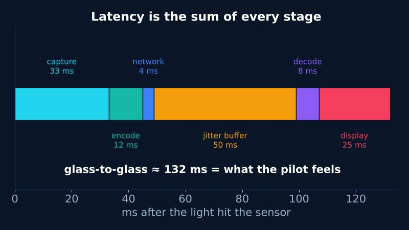

- **What you see:** The picture is always behind reality: the gripper closes, the video shows it a moment later.
- **Why:** Every stage adds delay: exposure, encoder look-ahead, network, jitter buffer, decode and the display queue.
- **On our ROV:** Above ≈ 150 ms pilots over-correct; a manipulator grab becomes trial and error.
- **Confirm:** Film a ms clock on the pilot laptop, photograph camera view and clock together, 10 repeats, report median and worst.
- **Fix:** Measure each stage, then remove the biggest: zerolatency, no B-frames, small jitter buffer, UDP, game-mode display.

#### Latency drift

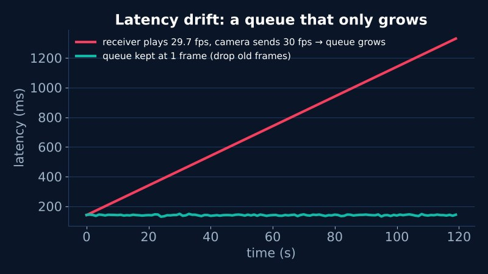

- **What you see:** The stream starts sharp, then the delay grows minute by minute.
- **Why:** Frames arrive faster than they are shown, so a queue somewhere only grows (a 30 vs 29.7 fps mismatch adds 10 ms every second).
- **On our ROV:** After 10 minutes of a dive the pilot can be seconds behind without noticing.
- **Confirm:** Plot latency over 10 minutes and queue depth at every stage; a straight rising line is a queue, not the network.
- **Fix:** Bound every queue to 1–2 frames and drop the oldest frame; for low latency use sync=false / no-buffer on the player.

#### Jitter

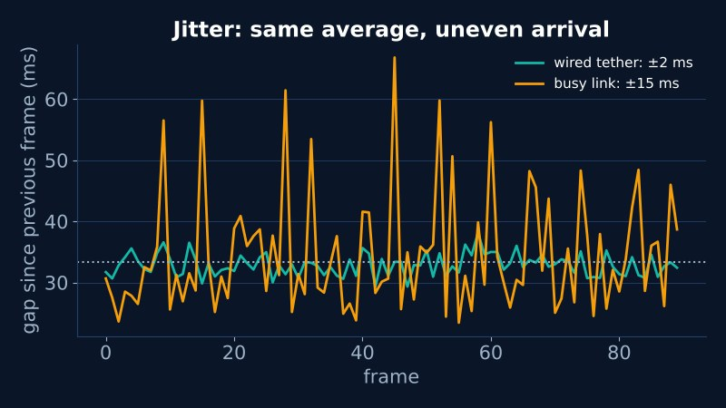

- **What you see:** Motion is uneven: some frames come early, some late, although the average is right.
- **Why:** Packets and frames take different times through switches, Wi-Fi, CPU scheduling and the encoder.
- **On our ROV:** The jitter buffer must be as deep as the worst jitter, and every ms of buffer is a ms of latency.
- **Confirm:** RFC 3550 jitter from rtp_probe.py or chrome://webrtc-internals; frame-interval histogram at the receiver.
- **Fix:** Wired tether, no Wi-Fi hop, QoS or a dedicated video link, then size the jitter buffer to the measured p95.

#### Frozen / stale frame

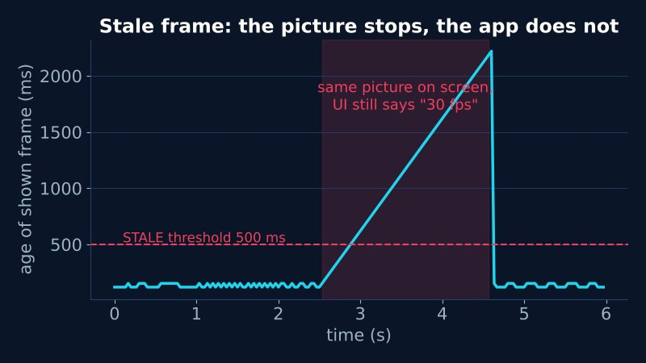

- **What you see:** The picture stops but the app looks alive: same frame, FPS counter still says 30.
- **Why:** Capture, network or decoder stopped delivering, and the renderer keeps redrawing the last frame it has.
- **On our ROV:** A still scene and a dead stream look identical: the pilot keeps driving on an old picture.
- **Confirm:** Show the age of the displayed frame (now − capture timestamp) and the time since the last packet.
- **Fix:** Show a STALE badge after 500 ms without a new frame, and LOST after a few seconds; never show success the system has not confirmed.

#### Uneven frame pacing

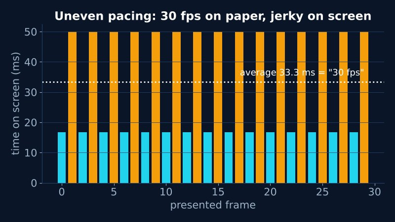

- **What you see:** Panning looks jerky although the counter reports a steady 30 fps.
- **Why:** Frames are shown for 17, 50, 17, 50 ms: the average is right, the rhythm is not (vsync, timer resolution, bursty delivery).
- **On our ROV:** Jerky motion makes small, slow manipulator moves hard to judge.
- **Confirm:** Log presentation timestamps and plot the intervals; the counter alone hides this.
- **Fix:** Present on vsync with a 1-frame queue, match camera fps to the display, avoid timers coarser than the frame time.

#### Frame bursts

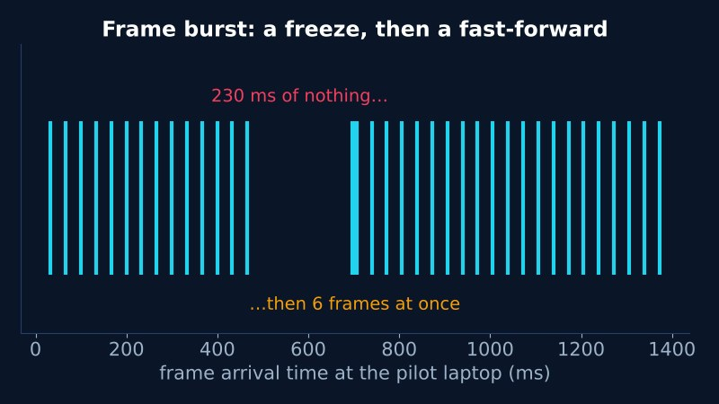

- **What you see:** The video freezes for a moment, then fast-forwards through several frames.
- **Why:** Frames were held somewhere (a congested switch, a TCP retransmission, a busy CPU) and released together.
- **On our ROV:** The pilot loses 200–300 ms of picture, then sees it too fast to use.
- **Confirm:** Frame arrival timestamps at the receiver: look for a gap followed by several frames within a few ms.
- **Fix:** Use UDP for live video, keep the CPU below 70 %, and drop late frames instead of playing them all.

#### Encoder hold-back

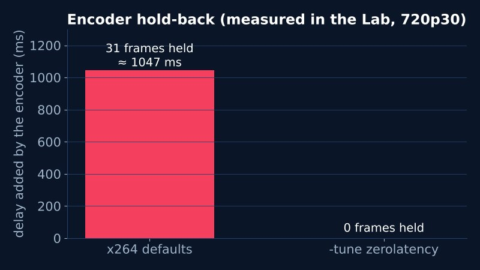

- **What you see:** A constant delay of about a second appears after switching encoder or preset.
- **Why:** x264 defaults use look-ahead, B-frames and frame threads; it holds 30+ frames before the first output.
- **On our ROV:** Measured in the Lab: defaults held 31 frames (≈ 1047 ms) at 720p30; -tune zerolatency held 0.
- **Confirm:** Encoding Lab → Live camera: the 'held' metric; or count frames in vs packets out.
- **Fix:** -tune zerolatency (x264), -tune ull / -delay 0 / -bf 0 (NVENC), -bf 0 for every live encoder.

#### Display lag

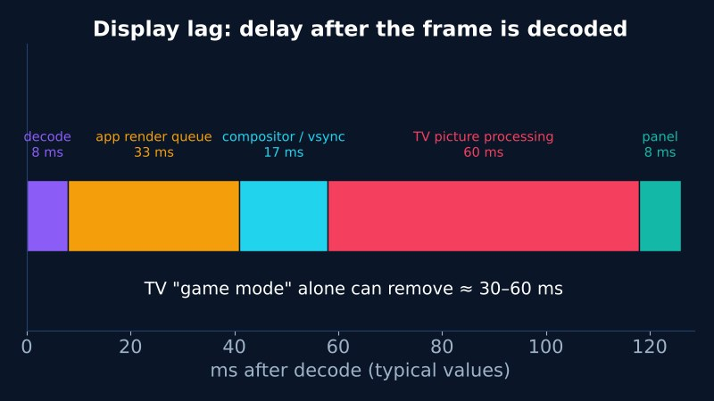

- **What you see:** The video is behind the telemetry or the mouse pointer on the same screen.
- **Why:** After decoding, frames wait in the app's render queue, the compositor and the TV's picture processing.
- **On our ROV:** A TV used as pilot monitor can add 30–60 ms by itself.
- **Confirm:** Film the pilot screen and a ms clock on a second screen; compare a game-mode and a normal display.
- **Fix:** Game mode on TVs, a monitor instead of a TV, 1-frame render queue, fullscreen to skip the compositor.

### Compression

*The encoder had too few bits for what the camera sees.*

#### Blocking / macroblocking

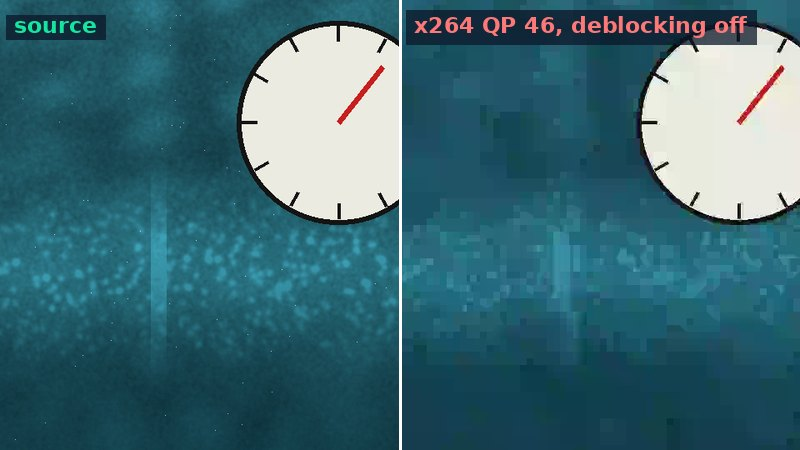

- **What you see:** Square tiles appear, worst in busy scenes and right after the camera moves.
- **Why:** Too few bits: the quantizer is so coarse that each block becomes one flat colour; the deblocking filter can only hide part of it.
- **On our ROV:** Marine snow and moving sediment eat bits, so blocks appear exactly when the pilot needs detail.
- **Confirm:** Encoding Lab → Encode at your bitrate: Frame compare with Diff ×8; check QP and bits per pixel.
- **Fix:** More bitrate for that camera, fewer pixels or fps for it, a better codec (H.265/AV1 in hardware), or better lighting.

#### Ringing / mosquito noise

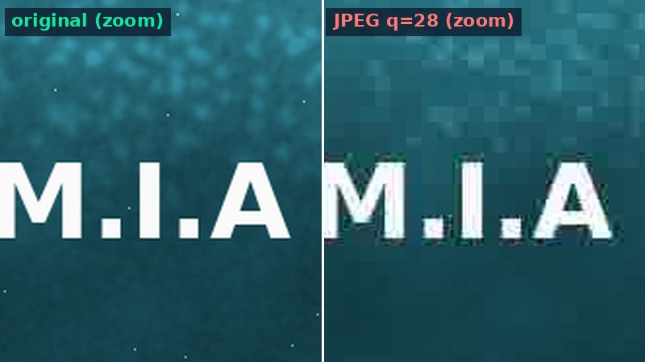

- **What you see:** Shimmering dots and halos around sharp edges: text, gauges, cable outlines.
- **Why:** Quantization removes the high frequencies that make an edge sharp; what remains oscillates around it.
- **On our ROV:** Gauge needles and printed markings (the things you inspect) are high-contrast edges.
- **Confirm:** Zoom on an edge in Frame compare; MJPEG at low quality shows it most.
- **Fix:** Raise quality for that camera, avoid sharpening in the camera (it adds edges to encode), draw text overlays after decoding.

#### Blur / loss of detail

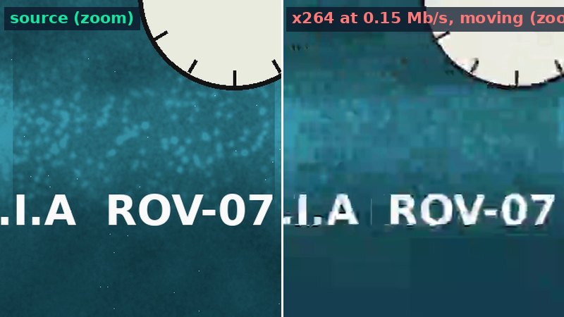

- **What you see:** Fine detail disappears, especially while the ROV or the object moves.
- **Why:** A bitrate cap forces the encoder to drop detail; the deblocking filter smooths what is left.
- **On our ROV:** Cracks, corrosion and small text on a prop vanish during the moment the pilot is looking for them.
- **Confirm:** SSIM / VMAF in the Encoding Lab at your real bitrate; compare still and moving parts of the clip.
- **Fix:** Bitrate for the camera that needs detail (main stream), lower fps rather than resolution for inspection cameras.

#### Pixelation

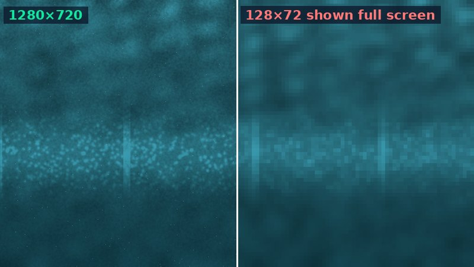

- **What you see:** The picture looks like coarse squares even without movement.
- **Why:** A small stream is scaled up to a big window (a 640×360 substream shown full screen), or the encoder was given very few pixels.
- **On our ROV:** Substreams are for thumbnails; shown full screen they look broken.
- **Confirm:** Compare stream resolution with window size; ffprobe the stream.
- **Fix:** Switch to the main stream when a camera goes full screen; scale with bilinear or better, never nearest.

#### Colour banding

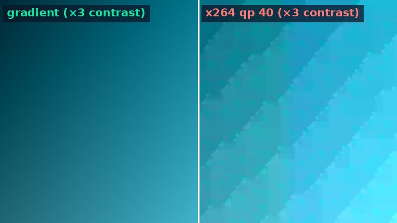

- **What you see:** Smooth gradients (open water, a lit wall) turn into visible steps.
- **Why:** 8-bit video has 256 levels; quantization merges neighbouring levels in flat areas into wide bands.
- **On our ROV:** Open water is one big gradient, so banding shows on almost every camera.
- **Confirm:** Look at a flat gradient; banding grows as QP rises.
- **Fix:** A little more bitrate, x264 aq-mode / psy settings, 10-bit H.265 where hardware supports it, keep some sensor noise (it dithers).

#### Keyframe pile-up

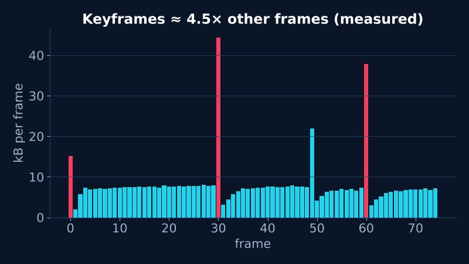

- **What you see:** Periodic hiccups or latency spikes once per GOP, worse with more cameras.
- **Why:** A keyframe is ≈ 4.5× a normal frame (measured); cameras started together send their keyframes in the same 33 ms.
- **On our ROV:** On a thin tether the combined burst queues for tens of ms every second.
- **Confirm:** Bitrate over time in the Encoding Lab shows the spikes; Bandwidth budget shows the pile-up delay.
- **Fix:** Stagger camera start-up, use intra refresh instead of big I-frames, cap with VBV (-maxrate/-bufsize).

### Network and transport

*Bits were lost, late or never sent.*

#### Packet-loss artifacts

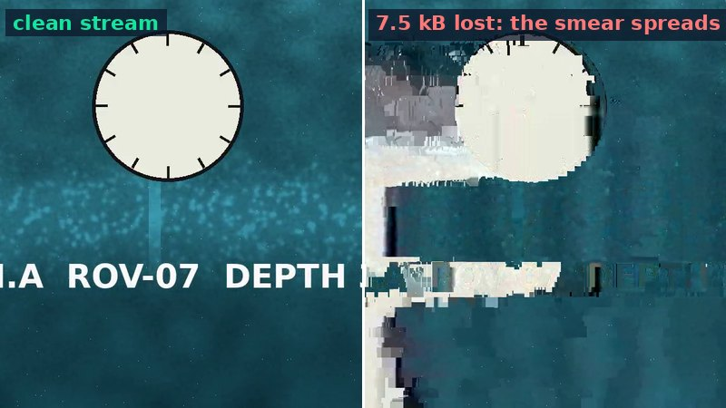

- **What you see:** Smears and wrong blocks that slide around and only clear at the next keyframe.
- **Why:** A lost packet removes part of a frame; every later frame predicts from the broken one, so the damage spreads.
- **On our ROV:** On UDP a 1 s GOP shows the error for up to a second; a long GOP for several seconds.
- **Confirm:** rtp_probe.py loss % per camera; Bandwidth budget → Packet-loss lab to see it on your clip.
- **Fix:** Fix the link first (connectors, powerline noise), then shorter GOP or intra refresh, and FEC if loss stays.

#### Decoder corruption (green / grey blocks)

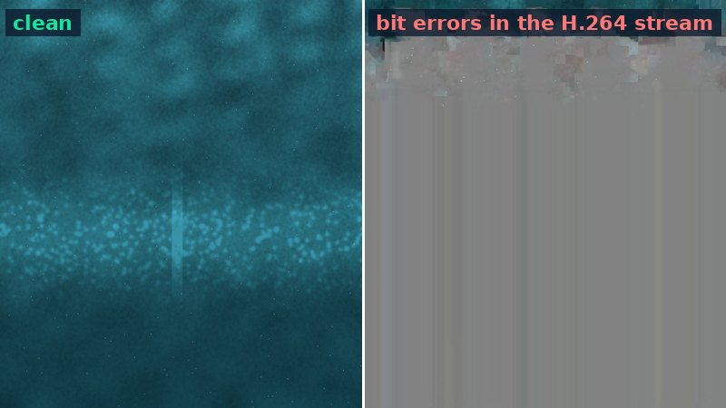

- **What you see:** Green or grey rectangles, half-drawn frames, garbage after a stream starts or recovers.
- **Why:** The decoder got a damaged bitstream or started without the reference frame it needs (joined mid-GOP).
- **On our ROV:** Joining a camera mid-stream shows garbage until the next keyframe.
- **Confirm:** FFmpeg logs ('error while decoding MB', 'non-existing PPS'); count decode errors per minute.
- **Fix:** Request a keyframe on join, send SPS/PPS with every keyframe (repeat-headers / config-interval=1), check memory and cables.

#### Buffering

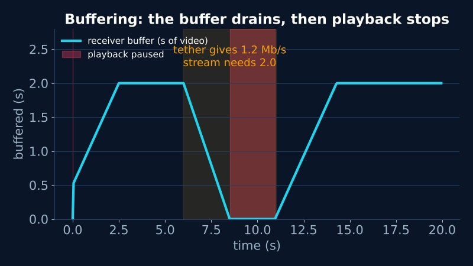

- **What you see:** Playback pauses with a spinner, then continues.
- **Why:** The receiver buffer drains because the stream needs more than the link delivers.
- **On our ROV:** Players built for the internet (HLS, a browser <video>) buffer seconds: never use them for piloting.
- **Confirm:** Compare stream bitrate with iperf3 throughput; watch the player's buffer level.
- **Fix:** Bitrate under 70 % of measured throughput, a live protocol (RTP/WebRTC), and a player that drops instead of waits.

#### Intermittent dropouts

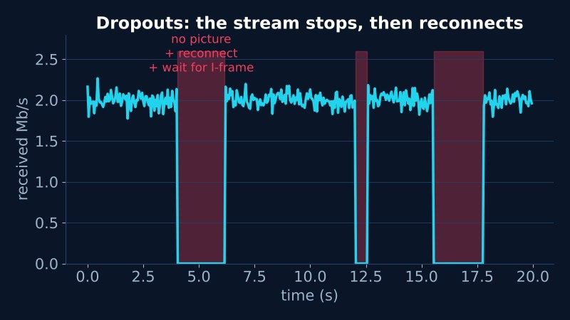

- **What you see:** The picture disappears for seconds and comes back.
- **Why:** The link or socket closes and reopens: a loose connector, a reboot, an encoder crash, a powerline adapter resyncing.
- **On our ROV:** Each dropout costs reconnect time plus the wait for the next keyframe.
- **Confirm:** dmesg / journalctl on both ends for link down/up; ethtool -S error counters; a timestamped log of reconnects.
- **Fix:** Strain-relieve tether connectors, separate power from video, auto-reconnect with exponential back-off, LOST state in the UI.

#### Link at the wrong speed

```
$ ethtool eth0
  Speed: 10Mb/s   ← want 100
  Duplex: Half    ← want Full
```

- **What you see:** Everything works on the bench, but on the tether the video is slow, lossy or late.
- **Why:** A long or damaged cable, or a bad pair, makes Ethernet fall back to 10 Mb/s or half duplex.
- **On our ROV:** One bad pair in a 20 m tether turns 94 Mb/s into ≈ 9 Mb/s.
- **Confirm:** ethtool on both ends, then iperf3 through the real tether.
- **Fix:** Re-terminate or replace the tether, check pairs with a cable tester, pin the speed only if both ends agree.

#### IP fragmentation

```
$ tcpdump -ni eth0 'ip[6:2]&0x3fff!=0'
  IP … frag (id 4512) …
  → the video is being fragmented
```

- **What you see:** Loss is much worse than the link statistics suggest, especially at high bitrate.
- **Why:** UDP datagrams bigger than the MTU are split; losing any fragment loses the whole datagram.
- **On our ROV:** Some powerline adapters and tunnels have an MTU below 1500 bytes.
- **Confirm:** tcpdump for fragments; ping -M do -s 1472 to find the real MTU.
- **Fix:** Keep RTP payloads ≤ 1200–1400 bytes (pkt_size / mtu on the payloader); never send raw frames as one datagram.

### Motion

*Something moves faster than the camera, encoder or screen can follow.*

#### Rolling shutter

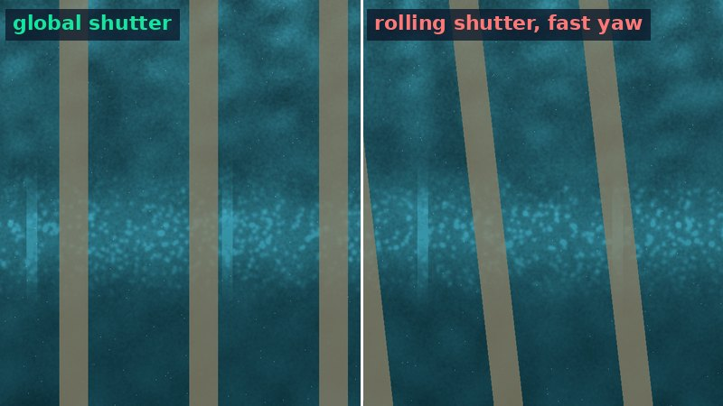

- **What you see:** Vertical things (piles, pipes, the gripper) lean or bend while the ROV yaws.
- **Why:** Most cheap sensors read rows one after another; the bottom row is captured up to a frame later than the top.
- **On our ROV:** Fast yaw is normal for an ROV; measurements from a skewed picture are wrong.
- **Confirm:** Pan quickly past a vertical edge; the lean grows with yaw speed.
- **Fix:** Global-shutter camera for measurement/CV, faster sensor readout modes, slower yaw while measuring.

#### Ghosting

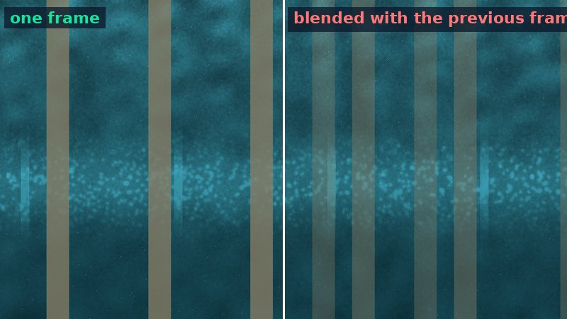

- **What you see:** Moving objects leave faint trails or a second copy.
- **Why:** Frames are blended: temporal noise reduction in the camera, frame-rate conversion, or a slow display.
- **On our ROV:** Camera noise reduction is tuned for still scenes, not a moving ROV.
- **Confirm:** Wave something quickly in front of the camera; trails appear before encoding?
- **Fix:** Turn temporal noise reduction down in the camera (v4l2-ctl), avoid frame-rate conversion, fast-response display.

#### Motion blur

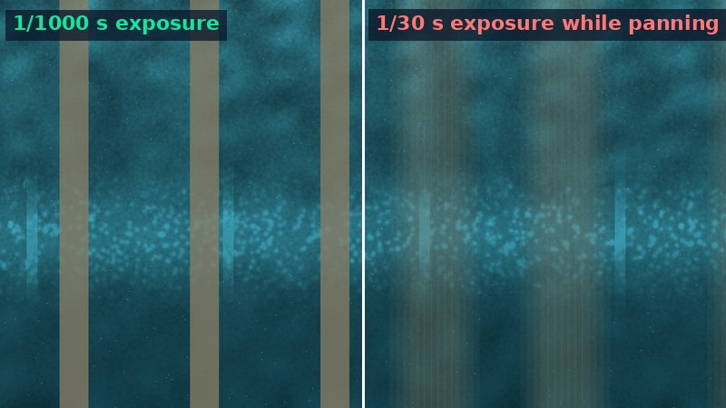

- **What you see:** Moving things are smeared, even though every frame arrives on time.
- **Why:** Long exposure: in low light the camera keeps the shutter open for most of the frame time.
- **On our ROV:** Under water the camera is often light-starved, so exposure grows automatically.
- **Confirm:** Read exposure_time_absolute with v4l2-ctl while moving; blur that is in every frame is optical, not network.
- **Fix:** More light, a fixed shorter exposure (raise gain a little), a faster lens.

#### Judder

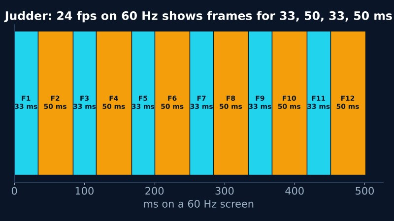

- **What you see:** Panning moves in uneven steps, repeating some frames.
- **Why:** The camera rate and the display rate do not divide: 25 or 24 fps on 60 Hz shows frames for 2 then 3 refreshes.
- **On our ROV:** Cameras that default to 25 fps (PAL) on a 60 Hz pilot screen.
- **Confirm:** Compare camera fps (v4l2-ctl --get-parm) with the display refresh rate.
- **Fix:** Use 30 or 60 fps cameras on 60 Hz screens, or set the display to 50 Hz for 25 fps cameras.

#### Combing (interlacing)

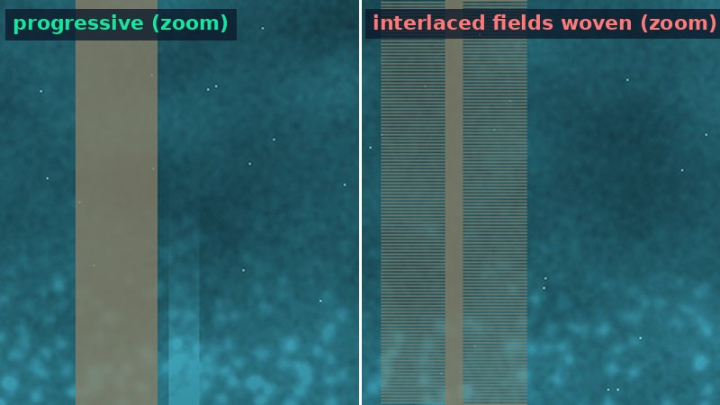

- **What you see:** Moving edges show horizontal comb teeth.
- **Why:** An interlaced source (old analog cameras, capture cards) sends odd and even lines from different moments.
- **On our ROV:** Analog/AHD cameras through a USB capture dongle are often interlaced.
- **Confirm:** ffprobe field_order; pause on motion and zoom.
- **Fix:** Deinterlace before encoding (FFmpeg yadif / bwdif), or use progressive digital cameras.

#### Strobing (wagon-wheel)

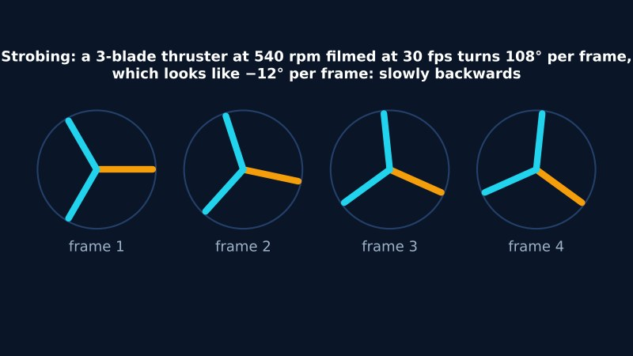

- **What you see:** Thruster blades seem frozen or turning slowly backwards.
- **Why:** The frame rate samples a periodic motion too slowly: each frame the blade is almost where another blade was.
- **On our ROV:** Harmless for piloting, but it confuses anyone judging thruster speed from video.
- **Confirm:** Change the frame rate: the apparent speed changes.
- **Fix:** Do not judge rotation from video; use telemetry (ESC rpm) instead.

### Camera and optics

*The problem is in the picture before any encoding: water, light, lens, sensor.*

#### Low visibility / haze

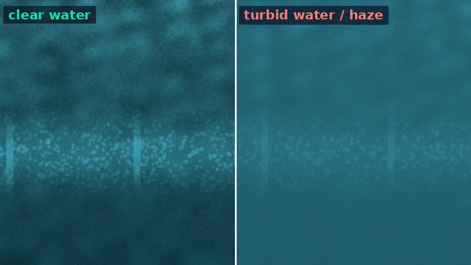

- **What you see:** Washed-out, low-contrast, everything the colour of the water.
- **Why:** Turbidity scatters light between the object and the lens; contrast falls with distance.
- **On our ROV:** The pool after thrusters stir the floor, or murky open water.
- **Confirm:** Same scene clear vs stirred; it is in the raw camera image, so encoding cannot fix it.
- **Fix:** Get closer, light from the side, contrast stretch / CLAHE for display (after decoding, for the pilot only).

#### Backscatter

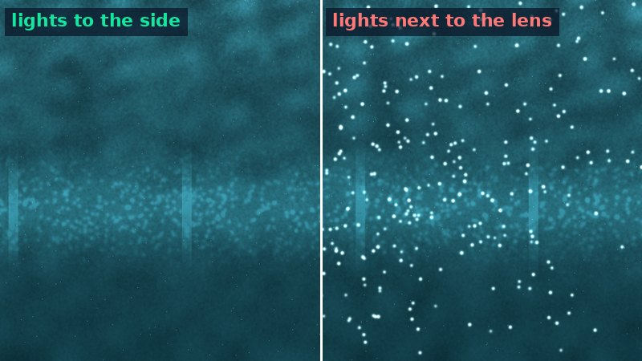

- **What you see:** Bright floating specks all over the picture, worst near the lights.
- **Why:** Light from lamps next to the lens reflects off particles straight back into the camera.
- **On our ROV:** Specks are new detail in every frame: they cost bits and trigger false CV detections.
- **Confirm:** Turn the lights off and on, or move them: the specks follow the light geometry.
- **Fix:** Mount lights away from and behind the lens plane, angled outward; dim them in turbid water.

#### Sensor noise

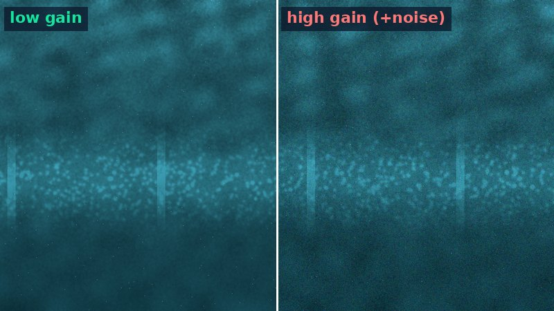

- **What you see:** Grain and fizzing pixels, even when nothing moves.
- **Why:** Low light makes the camera raise gain, which amplifies sensor noise; heat adds more.
- **On our ROV:** Noise is detail the encoder must send: measured 1.41 → 5.12 Mb/s (× 3.6) at the same CRF.
- **Confirm:** Bitrate of a still scene: it should be tiny; a high still-scene bitrate means noise.
- **Fix:** More light, lower gain, camera noise reduction (spatial), keep the electronics cool.

#### Focus problems

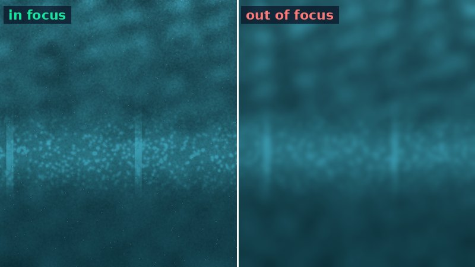

- **What you see:** Everything is soft, even a still scene with plenty of bitrate.
- **Why:** Wrong focus, a dirty or scratched port, or autofocus hunting through particles.
- **On our ROV:** Focus set in air shifts under water behind a flat port.
- **Confirm:** A still frame from the camera before encoding: blur there is optical.
- **Fix:** Focus under water and lock it (v4l2-ctl focus_auto=0), clean the dome, dome ports for wide lenses.

#### Over- / under-exposure

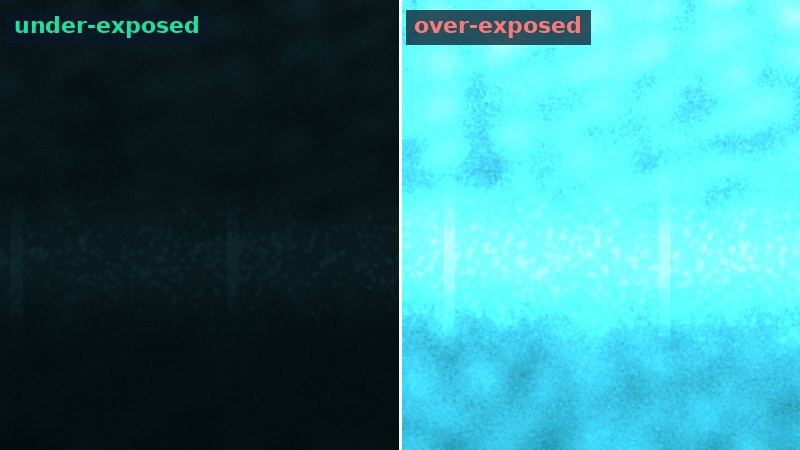

- **What you see:** Lost detail in the bright (blown white) or dark (crushed black) parts.
- **Why:** Auto exposure averages the whole frame; a bright lit target on black water fools it.
- **On our ROV:** The lit object the pilot cares about is exactly what auto exposure gets wrong.
- **Confirm:** Histogram of a raw frame; v4l2-ctl exposure/gain values.
- **Fix:** Manual exposure for the task, or spot/centre metering if the camera has it; adjust light power.

#### White balance / colour cast

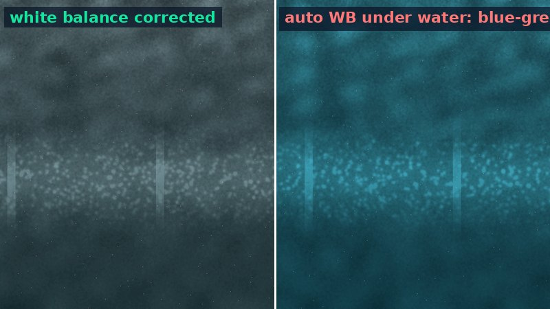

- **What you see:** Everything is blue-green, reds are gone.
- **Why:** Water absorbs red first; auto white balance under water has nothing white to lock on to.
- **On our ROV:** Colour-coded cables, red markers and rust are hard to tell apart.
- **Confirm:** Hold a white/grey card in front of the camera at depth.
- **Fix:** Manual white balance at working depth (v4l2-ctl white_balance_temperature), red filter, or colour correction after decoding.

#### Condensation in the housing

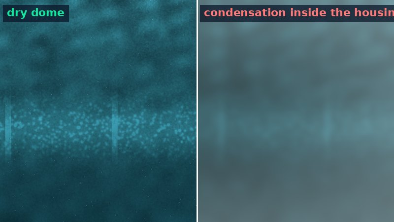

- **What you see:** A milky fog that grows during the dive, worst in the centre of the dome.
- **Why:** Warm, moist air sealed in the housing condenses on the cold dome when the ROV enters cold water.
- **On our ROV:** Looks like turbid water but does not change when the ROV moves.
- **Confirm:** Fog that stays fixed to the camera, not the scene; fog that clears when the electronics heat the dome.
- **Fix:** Seal the housing in dry air, add silica gel, keep heat-producing boards away from the dome.

#### Light banding (PWM)

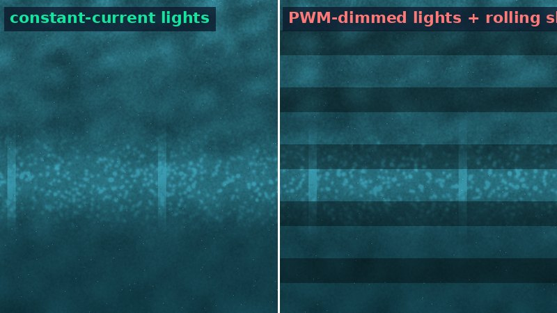

- **What you see:** Dark horizontal bands that roll slowly up or down the picture.
- **Why:** PWM-dimmed LEDs blink faster than the eye sees; a rolling-shutter sensor captures the blinking row by row.
- **On our ROV:** Dimmable ROV lights driven by PWM from the ESC or controller.
- **Confirm:** Bands change with light brightness and vanish with the lights at 100 % or off.
- **Fix:** Constant-current LED drivers, a PWM frequency far above the line rate, or an exposure that is a multiple of the PWM period.

#### Flicker

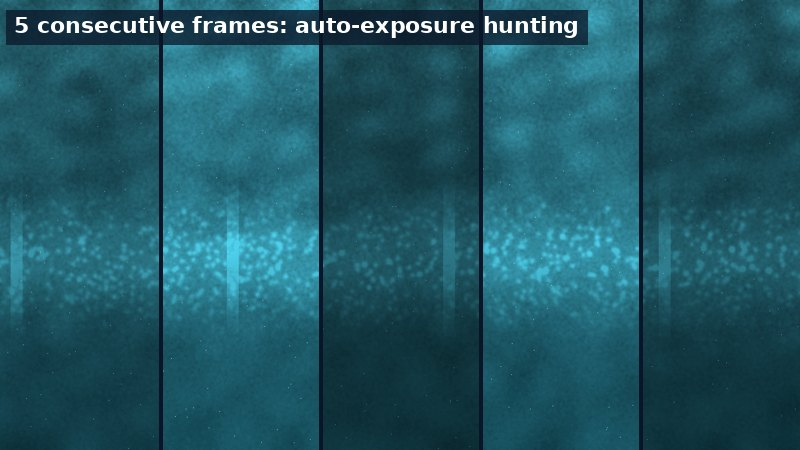

- **What you see:** The brightness of the whole picture pumps up and down between frames.
- **Why:** Auto exposure hunting on a changing scene, mains-powered lights (50/60 Hz), or rendering sync problems.
- **On our ROV:** Pumping brightness also makes the encoder spend bits on every frame.
- **Confirm:** Plot mean frame brightness over time; set exposure to manual and see if it stops.
- **Fix:** Manual or slower auto exposure, power_line_frequency set correctly, steady lights.

### Display and sync

*The frames arrive fine; showing them goes wrong.*

#### Tearing

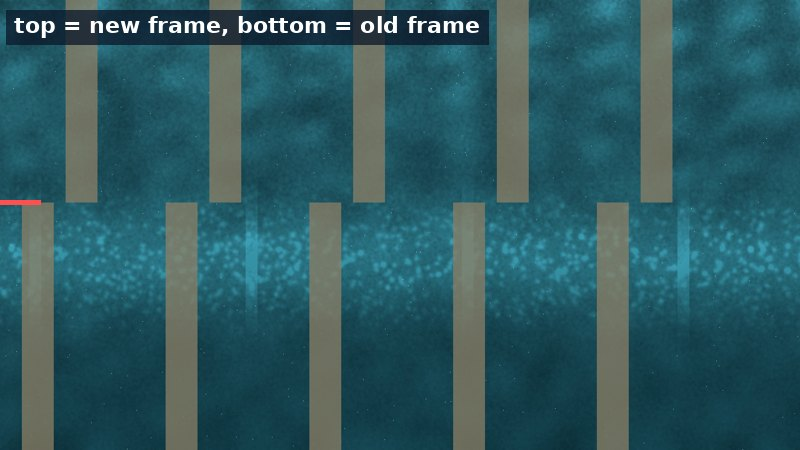

- **What you see:** A horizontal line where the top and bottom of the picture do not match.
- **Why:** The screen is refreshed while the next frame is being copied in (no vsync), or a capture grabs half-updated memory.
- **On our ROV:** Distracting during fast yaw; a screen recording of the GUI shows it too.
- **Confirm:** Turn vsync on: if it disappears, it was the display path.
- **Fix:** Present with vsync / double buffering (OpenGL swap interval 1), copy whole frames between threads.

#### Black frames

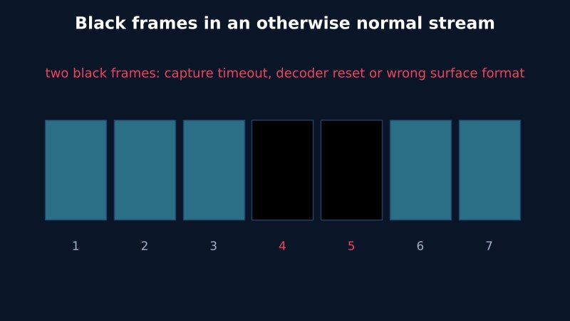

- **What you see:** Single black frames or a black window although data is arriving.
- **Why:** Capture timeout, a decoder reset, a surface format the renderer does not support, or HEVC in a browser that cannot decode it.
- **On our ROV:** A browser without H.265 support shows black for an H.265 stream with no error.
- **Confirm:** Decoder log and the browser console; chrome://media-internals shows the decoder in use.
- **Fix:** H.264 for browser pilots, check the pixel format (yuv420p), handle decoder errors by requesting a keyframe.

#### Wrong aspect ratio

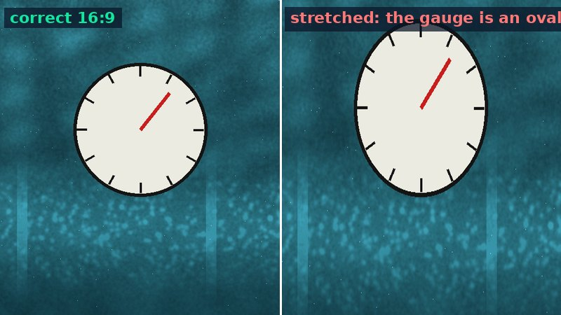

- **What you see:** Round things are ovals, the picture looks squashed or stretched.
- **Why:** The stream size and the window or the pixel aspect ratio do not match (a 4:3 camera in a 16:9 box).
- **On our ROV:** Distances and sizes read from video are wrong.
- **Confirm:** ffprobe width, height and sample_aspect_ratio; compare with the window.
- **Fix:** Letterbox instead of stretch (object-fit: contain), set SAR 1:1, keep the camera's native shape.

#### Resolution switching

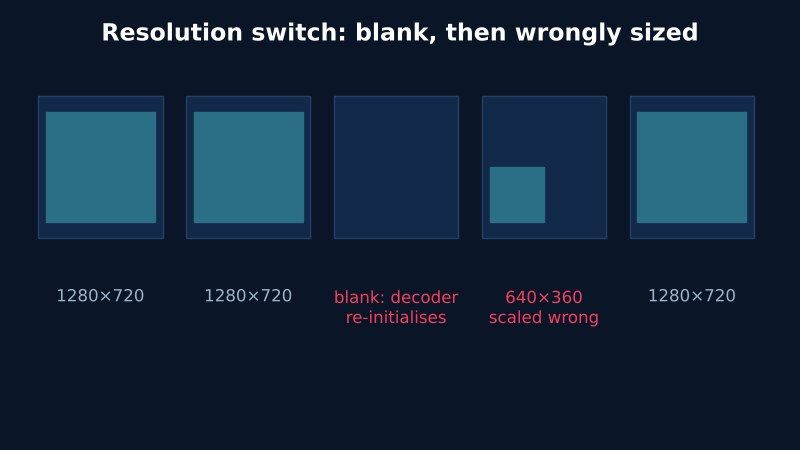

- **What you see:** A blank moment, then the picture is the wrong size or position.
- **Why:** The source changed resolution (camera restart, adaptive stream) and the decoder/renderer had to reinitialise.
- **On our ROV:** Switching a camera between main and substream causes this every time.
- **Confirm:** Log decoder reconfiguration events with timestamps.
- **Fix:** Fixed output size with scaling in the renderer, keep the last frame until the new one decodes.

#### Colour range / colour space

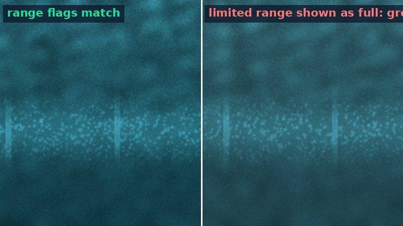

- **What you see:** Washed-out greys where black should be, or crushed blacks and clipped whites.
- **Why:** Video uses 16–235 (limited range); a player that assumes 0–255 shows it washed out, or the reverse crushes it.
- **On our ROV:** OpenGL/WebGL renderers that convert YUV → RGB themselves often get this wrong.
- **Confirm:** ffprobe color_range; render a known black/white test pattern.
- **Fix:** Tag the stream (-color_range tv) and convert with the matching matrix (BT.601 vs BT.709) in the shader.

#### Telemetry–video (and audio) desync

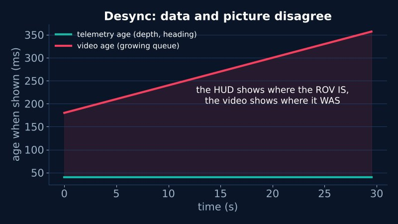

- **What you see:** The depth or heading overlay disagrees with what the video shows; audio, if any, drifts.
- **Why:** Telemetry arrives in milliseconds while video waits in buffers; separate clocks drift apart.
- **On our ROV:** The HUD shows where the ROV is, the video shows where it was.
- **Confirm:** Timestamp both at the ROV; show their age difference in the GUI.
- **Fix:** Delay telemetry to match video for the overlay, or show both ages; one clock (PTP/chrony) for all timestamps.

### The ROV computer

*The hardware runs out of something: heat, USB, CPU, a shared clock.*

#### Thermal throttling

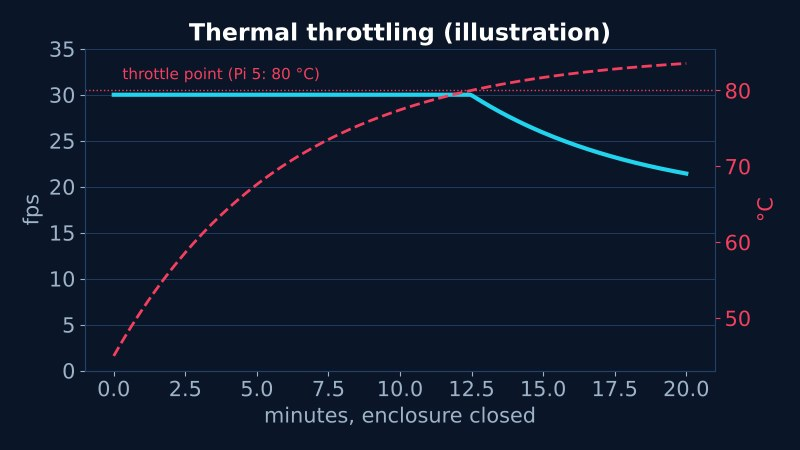

- **What you see:** Fine on the bench, FPS drops after 10–15 minutes in the sealed hull.
- **Why:** The SoC slows its clocks when hot; a closed enclosure in warm water cannot get rid of the heat.
- **On our ROV:** Our 2023 heat failure: everything passed the bench test.
- **Confirm:** vcgencmd get_throttled / measure_temp (Pi), tegrastats (Jetson) during a 30-minute soak test, enclosure closed.
- **Fix:** Heat sink to the hull, fan inside, lower encoder load (hardware encoder), log temperature with the video.

#### USB bandwidth

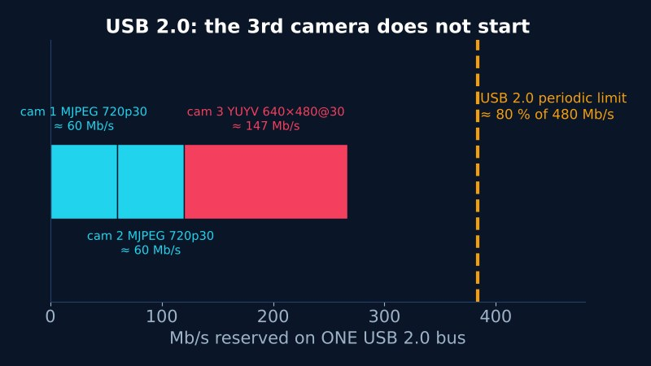

- **What you see:** The third or fourth camera refuses to start ('No space left on device') or drops frames.
- **Why:** USB 2.0 reserves bandwidth per camera; uncompressed modes reserve a lot and the bus runs out.
- **On our ROV:** All cameras on one hub share one 480 Mb/s bus.
- **Confirm:** lsusb -t (which bus), v4l2-ctl --list-formats-ext (MJPEG vs YUYV), dmesg.
- **Fix:** MJPEG modes, spread cameras over separate USB controllers, USB 3.0 ports, lower fps for aux cameras.

#### CPU saturation

```
$ htop
  CPU0 [||||||||100%]  ffmpeg
  CPU1 [||||||||100%]  ffmpeg
  → decode → scale → encode
```

- **What you see:** FPS falls and latency rises together when more cameras or a GUI are added.
- **Why:** Software encode, the resolution trap (decode → scale → encode) or colour conversion runs out of CPU.
- **On our ROV:** One resized MJPEG camera costs ≈ 13 % of a core; software H.264 on a Pi 5 ≈ 0.6–0.9 core per 1080p30.
- **Confirm:** htop per thread; the Lab's Bandwidth budget → Measure this computer.
- **Fix:** Hardware encoder, ask the camera for the size you need, stay under 70 % CPU.

#### Clock drift (bad measurements)

```
$ chronyc tracking
  System time: 0.183 s fast
  → every latency number
    is 183 ms wrong
```

- **What you see:** Latency numbers that are negative, jump, or slowly change for no reason.
- **Why:** Timestamps from two computers are compared, but their clocks disagree and drift.
- **On our ROV:** The ROV computer has no internet time under water; its clock drifts from the topside.
- **Confirm:** chronyc tracking on both ends; compare with the optical (ms-clock photo) measurement.
- **Fix:** Run chrony with the topside as the server (or PTP); use monotonic clocks for stage timings on one machine.

## Related

- [measuring-performance.md](measuring-performance.md): the measurement toolbox
- [gui-stream-metrics.md](gui-stream-metrics.md): throughput and loss in the pilot GUI
- [mjpeg-and-ffmpeg.md](mjpeg-and-ffmpeg.md): the resolution trap
- [jetson-nano-vs-pi5.md](jetson-nano-vs-pi5.md): encoder capacity and heat
- Encoding Lab: Encode (Frame compare, Bitrate over time), Live camera, Bandwidth budget (Packet-loss lab)
